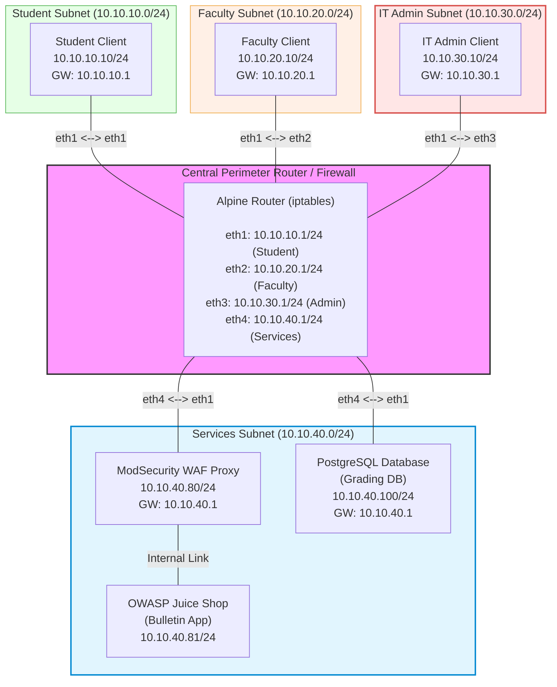

# Lab Assignment: Enterprise Campus Network Security & Application Defense

## Objective

In this comprehensive lab assignment, you will synthesize core enterprise network design concepts into a single campus simulation using **Containerlab**, **Alpine Linux**, **`iptables`**, and **OWASP ModSecurity WAF**.

You will design, configure, and secure a 4-subnet campus environment connecting Students, Faculty, IT Admin staff, and Centralized Services. The network requires both **Layer 3/4 Packet Filtering Firewalls** on the central router to enforce strict inter-subnet access policies and a **Layer 7 Web Application Firewall (WAF)** to defend vulnerable application services against web exploits.

---

## 1. Campus Network Architecture & Topology

The campus network consists of four distinct subnets connected through a central Alpine Linux Gateway / Firewall router:

1. **Student Subnet (`10.10.10.0/24`):** General student population client zone.
2. **Faculty Subnet (`10.10.20.0/24`):** Academic staff client zone.
3. **IT Admin Subnet (`10.10.30.0/24`):** Network and system administration client zone.
4. **Services Subnet (`10.10.40.0/24`):** Centralized campus servers, databases, and web applications.



---

## 2. Lab Objectives & Security Policies

### Policy 1: Gateway Routing & Inter-Subnet Stateful Filtering
* The central router must enable kernel IP forwarding (`sysctl -w net.ipv4.ip_forward=1`) and serve as default gateway (`.1`) for each subnet.
* Enforce stateful packet tracking (`ESTABLISHED,RELATED`) on `iptables` to allow return traffic automatically for established outbound sessions.
* Enforce a default `DROP` policy on the `FORWARD` filter chain.

### Policy 2: Admin SSH Privilege Restrictions
* **Only hosts residing on the IT Admin Subnet (`10.10.30.0/24`)** are permitted to initiate SSH connections (`tcp/22`) to devices/servers in any other subnet.
* All SSH traffic initiated from Student, Faculty, or Services subnets must be blocked and dropped by the central router firewall.

### Policy 3: Campus Web & Database Access Control
1. **School Bulletin App (OWASP Juice Shop):**
   * Must be accessible via HTTP (`tcp/80`) through the **ModSecurity WAF Proxy** (`10.10.40.80`) by **Students, Faculty, and IT Admin staff**.
   * Direct user connections from client subnets to the backend container directly (`10.10.40.81`) must be prevented or isolated; all HTTP user traffic must transit through the WAF.
2. **Grading Database (PostgreSQL):**
   * Accessible over PostgreSQL port (`tcp/5432`) on target IP `10.10.40.100`. Credentials set to `postgres/postgres`.
   * **Only Faculty (`10.10.20.0/24`) and IT Admin (`10.10.30.0/24`)** subnets may initiate connections to port 5432.
   * Access attempts from the Student subnet to the grading database must be dropped by the network firewall.

### Policy 4: Layer 7 WAF Protection Against SQL Injection
* The ModSecurity reverse proxy (`10.10.40.80`) front-ends the bulletin app.
* Standard legitimate web access through the WAF must yield an HTTP `200 OK` response.
* Requests containing SQL Injection attack vectors targeting the application (e.g., `' OR '1'='1`) must be intercepted by custom ModSecurity rules and return `403 Forbidden`.

---

## 3. Directory Layout & Custom Image Building Instructions

### Directory Structure

```
.
├── README.md                   # Lab setup and execution documentation
├── lab.clab.yml                # Master Containerlab topology definition file
├── config/
│   ├── iptables.rules          # Student-configured network firewall rules
│   └── modsec-custom.conf      # Student-configured Layer 7 WAF rules
└── images/
    ├── juiceshop/
    │   └── Dockerfile          # Custom Juice Shop build file (with iproute2)
    └── modsec/
        └── Dockerfile          # Custom ModSecurity build file (with iproute2)
```

### Pre-requisite: Local Image Builds

Because lightweight upstream application containers often omit networking utilities required by Containerlab for static IP/gateway configuration, you **must build custom local container images** prior to deploying the topology.

#### 1. Build Custom Juice Shop Image (`images/juiceshop/Dockerfile`)

```dockerfile
FROM node:24-trixie

USER root

RUN apt-get update && apt-get install -y --no-install-recommends \
    bash \
    iproute2 \
    iputils-ping \
    git \
    make \
    g++ \
    && rm -rf /var/lib/apt/lists/*

WORKDIR /juice-shop

RUN git clone --depth 1 https://github.com/juice-shop/juice-shop.git .
RUN npm install

EXPOSE 3000

CMD ["npm", "start"]
```

*Build Command:*
```bash
docker build -t custom-juiceshop:latest ./images/juiceshop
```

#### 2. Build Custom ModSecurity WAF Image (`images/modsec/Dockerfile`)

```dockerfile
FROM owasp/modsecurity-crs:nginx

USER root

RUN apt-get update \
    && apt-get install -y --no-install-recommends iproute2 iputils-ping \
    && rm -rf /var/lib/apt/lists/*
```

*Build Command:*
```bash
docker build -t custom-waf:latest ./images/modsec
```

---

## 4. Starter Templates

### Starter: `config/iptables.rules`

```text
*filter
:INPUT DROP [0:0]
:FORWARD DROP [0:0]
:OUTPUT ACCEPT [0:0]

# =======================================================
# TODO: IMPLEMENT YOUR IPTABLES RULES BELOW
# =======================================================

# --- 1. ALLOW ESTABLISHED & RELATED TRAFFIC ---


# --- 2. SSH MANAGEMENT ACCESS CONTROL ---
# Allow ONLY 10.10.30.0/24 (Admin) to initiate SSH anywhere


# --- 3. BULLETIN APP ACCESS CONTROL ---
# Allow Student, Faculty, and Admin to access WAF Proxy (10.10.40.80:80)


# --- 4. GRADING DATABASE ACCESS CONTROL ---
# Allow Faculty and Admin to access PostgreSQL DB (10.10.40.100:5432)


COMMIT
```

### Starter: `lab.clab.yml`

```yaml
name: campus-network-security

topology:
  nodes:
    # 1. Central Router / Firewall Node (Stock Alpine - Packages installed via exec)
    router:
      kind: linux
      image: alpine:latest
      exec:
        - apk add --no-cache iproute2 iptables
        - sysctl -w net.ipv4.ip_forward=1
        # TODO: Add interface IP addresses and load iptables.rules

    # 2. Subnet Clients
    student-client:
      kind: linux
      image: alpine:latest
      exec:
        - apk add --no-cache curl netcat-openbsd iproute2
        # TODO: Assign IP (10.10.10.10/24) and set default gateway (10.10.10.1)

    faculty-client:
      kind: linux
      image: alpine:latest
      exec:
        - apk add --no-cache curl netcat-openbsd iproute2
        # TODO: Assign IP (10.10.20.10/24) and set default gateway (10.10.20.1)

    admin-client:
      kind: linux
      image: alpine:latest
      exec:
        - apk add --no-cache curl netcat-openbsd iproute2
        # TODO: Assign IP (10.10.30.10/24) and set default gateway (10.10.30.1)

    # 3. Centralized Services Subnet
    waf-proxy:
      kind: linux
      image: custom-waf:latest
      env:
        BACKEND: "http://10.10.40.81:3000"
        MODSEC_RULE_ENGINE: "On"
      binds:
        - config/modsec-custom.conf:/etc/modsecurity.d/owasp-crs/rules/RESPONSE-999-CUSTOM.conf:ro
      exec:
        # TODO: Assign IP (10.10.40.80/24) and set default gateway (10.10.40.1)

    juiceshop-app:
      kind: linux
      image: custom-juiceshop:latest
      exec:
        # TODO: Assign IP (10.10.40.81/24)

    postgres-db:
      kind: linux
      image: postgres:15-alpine
      env:
        POSTGRES_USER: postgres
        POSTGRES_PASSWORD: postgres
        POSTGRES_DB: grading_db
      exec:
        # TODO: Assign IP (10.10.40.100/24) and set default gateway (10.10.40.1)

  links:
    # TODO: Define interface connections between nodes matching the topology map
```

---

## 5. Verification & Automated Test Suite

Your topology must successfully run and pass all six of the following test cases executed directly via `docker exec`:

### **Test 1: Legitimate Bulletin Web Access (Student to WAF)**
* **Command:** `docker exec -it clab-campus-network-security-student-client curl -s -o /dev/null -w "%{http_code}" http://10.10.40.80/`
* **Expected Result:** `200`

### **Test 2: ModSecurity WAF Interception of SQL Injection**
* **Command:** `docker exec -it clab-campus-network-security-student-client curl -s -o /dev/null -w "%{http_code}" "http://10.10.40.80/rest/user/login?email='OR'1'='1"`
* **Expected Result:** `403`

### **Test 3: Authorized Grading DB Access (Faculty Subnet)**
* **Command:** `docker exec -it clab-campus-network-security-faculty-client nc -zv -w 3 10.10.40.100 5432`
* **Expected Result:** `open` / connection succeeded

### **Test 4: Unauthorized Grading DB Access Block (Student Subnet)**
* **Command:** `docker exec -it clab-campus-network-security-student-client nc -zv -w 3 10.10.40.100 5432`
* **Expected Result:** Connection timeout / failure

### **Test 5: SSH Privilege Validation (IT Admin Host Allowed)**
* **Command:** `docker exec -it clab-campus-network-security-admin-client nc -zv -w 3 10.10.40.100 22`
* **Expected Result:** `open` / connection succeeded (or connection reset)

### **Test 6: SSH Privilege Restriction (Student Host Blocked)**
* **Command:** `docker exec -it clab-campus-network-security-student-client nc -zv -w 3 10.10.40.100 22`
* **Expected Result:** Connection timeout / failure

---

## 6. Submission Requirements

You must host your completed assignment in a **Public GitHub Repository** containing:

1. Valid `lab.clab.yml` topology definition.
2. Complete Dockerfiles under `images/juiceshop/` and `images/modsec/`.
3. Complete configuration files under `config/iptables.rules` (or use individual commands like [here](https://github.com/sealneaward/network-design/blob/main/tutorials/physical-firewalls.md#step-63-manual-cli-configuration-fallback-setup)) and `config/modsec-custom.conf`.
4. A comprehensive `README.md` file providing:
   * Prerequisites and local Docker image build instructions.
   * Containerlab deployment (`sudo clab deploy -t lab.clab.yml`) and destroy (`sudo clab destroy -t lab.clab.yml`) commands.
   * Step-by-step verification commands proving all security test cases pass.

---

## 7. Grading Rubric

This lab assignment is graded out of **100 total points**:

| Category | Description & Criteria | Weight | Points |
| :--- | :--- | :---: | :---: |
| **Repository Structure, Documentation & Execution** | • The GitHub repository is publicly accessible and properly structured.<br>• Custom Dockerfiles for Juice Shop and ModSecurity build cleanly.<br>• `README.md` documents deployment/destroy commands and prerequisites clearly.<br>• The `lab.clab.yml` topology builds and deploys via Containerlab without syntax or execution errors. | **25%** | **25 pts** |
| **Test 1: Bulletin Web Access** | Student node reaches WAF (`10.10.40.80:80`) and receives HTTP `200 OK`. | **12.5%** | **12.5 pts** |
| **Test 2: Layer 7 WAF Defense** | SQLi payload sent to WAF triggers custom rule and yields HTTP `403 Forbidden`. | **12.5%** | **12.5 pts** |
| **Test 3: Faculty DB Access** | Faculty host successfully connects to PostgreSQL DB (`10.10.40.100:5432`). | **12.5%** | **12.5 pts** |
| **Test 4: Student DB Restriction** | Student host attempt to reach PostgreSQL DB (`10.10.40.100:5432`) is dropped by firewall. | **12.5%** | **12.5 pts** |
| **Test 5: IT Admin SSH Privilege** | IT Admin host (`10.10.30.10`) successfully connects across subnets via SSH (`tcp/22`). | **12.5%** | **12.5 pts** |
| **Test 6: SSH Restriction Enforcement** | Non-admin host SSH attempts to other subnets are dropped by firewall. | **12.5%** | **12.5 pts** |
| **Total** | | **100%** | **100 pts** |