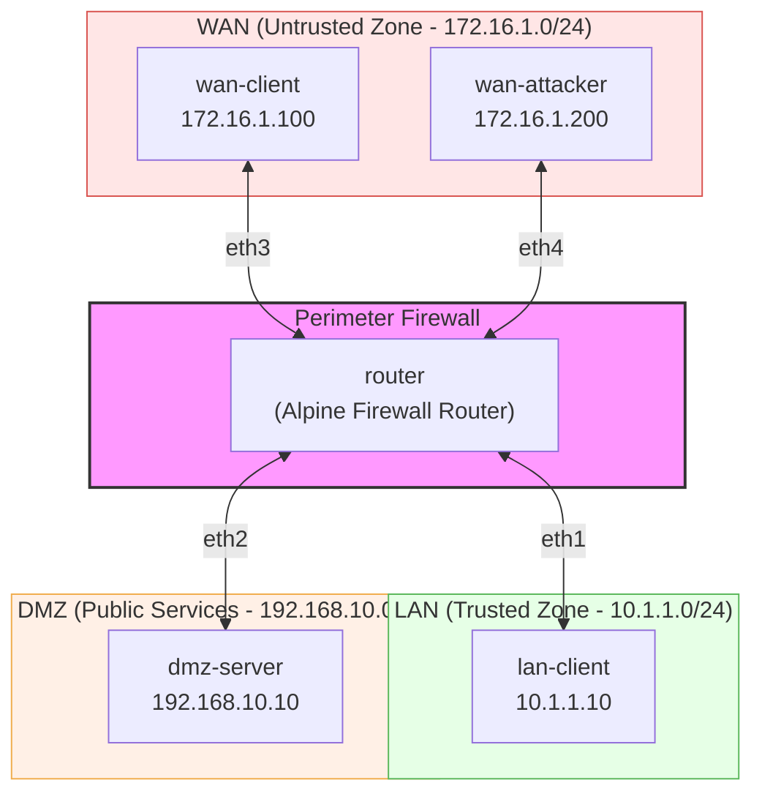

# IPTables Firewall Simulation Lab 

This assignment requires you to design, build, and document a multi-zone perimeter firewall simulation using **Containerlab**, **Alpine Linux**, and **`iptables`**.

## 1. Network Topology & Overview

You are required to simulate a classic three-zone security architecture:

* **LAN (Internal Office Network):** `10.1.1.0/24` — Trusted internal zone.
* **DMZ (Demilitarized Zone):** `192.168.10.0/24` — Public-facing web services.
* **WAN (Untrusted / External Internet):** `172.16.1.0/24` — External web clients and blacklisted threat actors.



## 2. Lab Security Objectives

You must design an `iptables` rule set that implements the following policy controls:

1. **Stateful Tracking:** Ensure all return traffic is allowed dynamically for established sessions.

2. **Threat Mitigation:** Block all incoming traffic originating from the malicious host (`172.16.1.200`), regardless of destination or port.

3. **LAN Policy:** Allow trusted LAN users full outbound access to services in the DMZ and WAN.

4. **DMZ Policy:** Allow external WAN clients (`eth3`) to access HTTP (`80/tcp`) and HTTPS (`443/tcp`) services on the DMZ web server (`192.168.10.10`). All other WAN-to-DMZ traffic (such as SSH or ICMP) must be blocked.

5. **Default Deny:** Enforce a default `DROP` policy on the `FORWARD` chain.

## 3. Directory & File Starter Templates

### Directory Layout

```
.
├── config/
│   └── iptables.rules      # Student-designed firewall rules file
├── lab.clab.yml            # Student-completed Containerlab topology file
└── README.md               # Student documentation
```

### `config/iptables.rules` (Starter Template)

*Complete this file according to the security objectives above.*

```text
*filter
:INPUT DROP [0:0]
:FORWARD DROP [0:0]
:OUTPUT ACCEPT [0:0]

# =======================================================
# TODO: IMPLEMENT YOUR IPTABLES RULES BELOW
# =======================================================

# --- 1. ALLOW ESTABLISHED & RELATED TRAFFIC ---


# --- 2. BLACKLIST / THREAT MITIGATION ---


# --- 3. LAN TO DMZ & WAN ACCESS ---


# --- 4. WAN TO DMZ ACCESS ---


COMMIT
```

### `lab.clab.yml` (Starter Template)

*Complete the node configurations, routes, and link definitions.*

```yaml
name: iptables-firewall-lab

topology:
  nodes:
    # Alpine Linux Firewall Router
    router:
      kind: linux
      image: alpine:latest
      # TODO: Complete mounts, package installations, IP definitions, and firewall commands

    # LAN Client
    lan-client:
      kind: linux
      image: alpine:latest
      # TODO: Configure IP address (10.1.1.10/24) and default gateway route

    # DMZ Web Server
    dmz-server:
      kind: linux
      image: nginx:alpine
      # TODO: Configure IP address (192.168.10.10/24) and default gateway route

    # WAN External Client
    wan-client:
      kind: linux
      image: alpine:latest
      # TODO: Configure IP address (172.16.1.100/24) and default gateway route

    # WAN Attacker / Blacklisted Host
    wan-attacker:
      kind: linux
      image: alpine:latest
      # TODO: Configure IP address (172.16.1.200/24) and default gateway route

  links:
    # TODO: Define interface connections between nodes matching the topology map
```

## 4. Verification & Expected Test Results

Your firewall must pass the following tests:

### **Test 1: Web Access from WAN Client to DMZ**

* **Command:** `docker exec -it clab-iptables-firewall-lab-wan-client curl -I http://192.168.10.10`
* **Expected Result:** `HTTP/1.1 200 OK`

### **Test 2: SSH Access from WAN Client to DMZ (Blocked)**

* **Command:** `docker exec -it clab-iptables-firewall-lab-wan-client nc -zv -w 3 192.168.10.10 22`
* **Expected Result:** Connection timeout / failure

### **Test 3: Blacklisted Attacker Access to DMZ (Blocked)**

* **Command:** `docker exec -it clab-iptables-firewall-lab-wan-attacker curl --connect-timeout 3 http://192.168.10.10`
* **Expected Result:** Connection timeout

### **Test 4: Direct Unsolicited WAN Access to Internal LAN (Blocked)**

* **Command:** `docker exec -it clab-iptables-firewall-lab-wan-client ping -c 3 10.1.1.10`
* **Expected Result:** 100% packet loss

### **Test 5: LAN Workstation Access to DMZ**

* **Command:** `docker exec -it clab-iptables-firewall-lab-lan-client curl -I http://192.168.10.10`
* **Expected Result:** `HTTP/1.1 200 OK`

## 5. Submission Requirements

You must create and submit a **Public GitHub Repository** containing:

1. **Topology File:** Valid `lab.clab.yml` that deploys cleanly via `sudo containerlab deploy`.
2. **Configuration Files:** The `config/` directory containing your `iptables.rules` and any other mounted configurations.
3. **Repository README.md:**
   * Instructions on how to deploy (`sudo clab deploy -t lab.clab.yml`) and destroy (`sudo clab destroy -t lab.clab.yml`) the lab environment.

You will submit the public repository URL so it can be cloned and marked.

## 6. Mark Breakdown

| Category | Description | Weight |
| --- | --- | --- |
| **Working Lab Environment** | The Containerlab topology builds without errors, nodes properly assign IP addresses, system routes bypass management defaults cleanly, and network connectivity exists across interfaces. The GitHub repository is publicly accessible. | **25%** |
| **Verification & Test Results** | Accurate implementation of `iptables` rulesets resulting in 100% passing results across all 5 mandatory security test cases listed in Section 4. | **75%** |
| **Total** | | **100%** |
