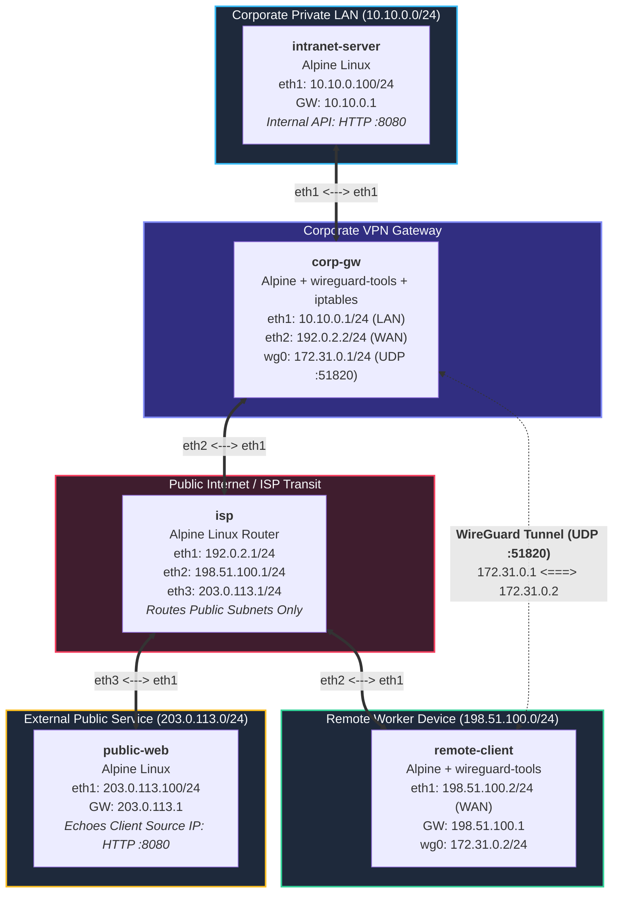

# Lab Assignment: Split-Tunnel vs. Full-Tunnel WireGuard VPN in Containerlab

## Overview & Objectives

The objective of this lab is to design, deploy, and analyze the behavioral and routing differences between a **Split-Tunnel VPN** and a **Full-Tunnel VPN** using **WireGuard** and **Containerlab**. 

In enterprise environments, remote clients (`remote-client`) connect across an untrusted public network (`isp`) to a corporate VPN gateway (`corp-gw`). Depending on security and bandwidth policies, administrators choose between two routing models:
1. **Split-Tunnel VPN:** Only traffic destined for internal corporate subnets (`10.10.0.0/24`) is routed into the encrypted WireGuard tunnel (`wg0`). General internet traffic (represented by `public-web`) bypasses the tunnel and exits directly through the client's local ISP gateway.
2. **Full-Tunnel VPN:** **All** traffic (`0.0.0.0/0`) from the remote client is forced through the WireGuard tunnel to `corp-gw`. Corporate traffic reaches the internal server (`intranet-server`), while internet-bound traffic is NATed (masqueraded) out of `corp-gw` so it appears to originate from the corporate public IP address.

Your primary task is to deploy the simplified topology, initially configure a **Split-Tunnel** policy, verify traffic paths and source IP visibility, and then transition the client and gateway to a **Full-Tunnel** policy (including policy routing/mark rules to prevent tunnel routing loops and outbound NAT on `corp-gw`).

---

## 1. Network Topology & IP Allocation

Use the diagram below to configure your Containerlab node interfaces, WireGuard tunnel endpoints, and subnet assignments across the Corporate LAN (`10.10.0.0/24`), Tunnel (`172.31.0.0/24`), and Public WAN (`192.0.2.0/24`, `198.51.100.0/24`, `203.0.113.0/24`) networks.



> **Host Prerequisite:** Ensure the `wireguard` kernel module is loaded on your Containerlab host machine prior to deployment (`sudo modprobe wireguard`).

---

## 2. Repository Directory Structure

Ensure your local repository matches the following structure before submitting:

```text
README.md
lab.clab.yml
keys/
```

---

## 3. Important: Key Management & Routing Loop Prevention

1. **Create a `keys` Directory (Not a File):** Before deploying, run `mkdir -p keys` on your host so `./keys:/tmp/keys` mounts cleanly as a directory containing `corp-gw.key`, `corp-gw.pub`, `remote-client.key`, and `remote-client.pub`.
2. **Always Use `--reconfigure`:** Whenever you modify `lab.clab.yml` and redeploy, run `sudo containerlab deploy -t lab.clab.yml --reconfigure` so startup commands and keys apply cleanly.
3. **Preventing the Full-Tunnel Routing Loop (`fwmark` / Host Route):** In Part 2 (Full Tunnel), setting `0.0.0.0/0` through `wg0` will trap WireGuard's own encrypted UDP packets (`192.0.2.2:51820`) inside the tunnel unless you exempt the VPN endpoint. You must add a specific host route on `remote-client` (`ip route add 192.0.2.2/32 via 198.51.100.1 dev eth1`) before replacing the default route (`0.0.0.0/0`) with `wg0` (or use `wg-quick`, which handles `fwmark` automatically).

---

## 4. Configuration & Topology Skeleton (`lab.clab.yml`)

Complete the skeleton YAML below so the lab deploys initially in **Part 1: Split-Tunnel Mode**:
1. **ISP Router (`isp`):** Configure IP addresses on `eth1`, `eth2`, and `eth3`, and enable IPv4 forwarding. Notice `isp` has **no** route to `10.10.0.0/24` or `172.31.0.0/24`.
2. **Corporate Gateway (`corp-gw`):** Configure LAN/WAN IPs, default route via `192.0.2.1`, IPv4 forwarding, key generation in `/tmp/keys`, and `wg0` (`172.31.0.1/24` on UDP `51820`) peered with `remote-client` (`AllowedIPs: 172.31.0.2/32`).
3. **Remote Client (`remote-client`):** Configure WAN IP (`198.51.100.2/24`), default route via `198.51.100.1`, key generation in `/tmp/keys`, and `wg0` (`172.31.0.2/24`) peered with `corp-gw` (`endpoint 192.0.2.2:51820`). For **Split-Tunnel Mode**, set `AllowedIPs` to `172.31.0.0/24,10.10.0.0/24` and add a static route for `10.10.0.0/24` via `wg0`.
4. **Servers (`intranet-server` & `public-web`):**
   * `intranet-server` serves `/tmp/intranet.json` (`{"service":"corporate-intranet","access":"vpn-only"}`) on port `8080`.
   * `public-web` runs a tiny Python HTTP service on port `8080` that returns the requester's visible source IP address (`{"visible_client_ip":"<ip>"}`), allowing you to prove whether internet traffic exited directly from `remote-client` (`198.51.100.2`) or via `corp-gw` (`192.0.2.2`).

```yaml
name: wg-split-full

topology:
  nodes:
    isp:
      kind: linux
      image: alpine:latest
      exec:
        - apk add --no-cache tcpdump iproute2
        # TODO: Configure eth1 (192.0.2.1/24), eth2 (198.51.100.1/24), eth3 (203.0.113.1/24), and enable IPv4 forwarding

    corp-gw:
      kind: linux
      image: alpine:latest
      binds:
        - ./keys:/tmp/keys
      exec:
        - apk add --no-cache wireguard-tools iptables tcpdump iproute2
        # TODO: Configure eth1 (10.10.0.1/24), eth2 (192.0.2.2/24), default route via 192.0.2.1, and IPv4 forwarding
        # TODO: Generate /tmp/keys/corp-gw.key & /tmp/keys/corp-gw.pub if missing; wait for /tmp/keys/remote-client.pub
        # TODO: Create wg0 (172.31.0.1/24) on UDP port 51820 and peer with remote-client (AllowedIPs: 172.31.0.2/32)

    remote-client:
      kind: linux
      image: alpine:latest
      binds:
        - ./keys:/tmp/keys
      exec:
        - apk add --no-cache wireguard-tools curl tcpdump iproute2
        # TODO: Configure eth1 (198.51.100.2/24), default route via 198.51.100.1, and IPv4 forwarding
        # TODO: Generate /tmp/keys/remote-client.key & /tmp/keys/remote-client.pub if missing; wait for /tmp/keys/corp-gw.pub
        # TODO: Create wg0 (172.31.0.2/24) and peer with corp-gw (192.0.2.2:51820) for SPLIT TUNNEL (AllowedIPs: 172.31.0.0/24,10.10.0.0/24)
        # TODO: Add static route for 10.10.0.0/24 via wg0

    intranet-server:
      kind: linux
      image: alpine:latest
      exec:
        - apk add --no-cache curl tcpdump iproute2
        # TODO: Configure eth1 (10.10.0.100/24) and default route via 10.10.0.1
        - sh -c 'echo '\''{"service":"corporate-intranet","access":"vpn-only"}'\'' > /tmp/intranet.json && nohup python3 -m http.server 8080 --bind 0.0.0.0 -d /tmp >/tmp/http.log 2>&1 &'

    public-web:
      kind: linux
      image: alpine:latest
      exec:
        - apk add --no-cache curl python3 tcpdump iproute2
        # TODO: Configure eth1 (203.0.113.100/24) and default route via 203.0.113.1
        - |
          sh -c 'cat << "EOF" > /tmp/whoami.py
          from http.server import BaseHTTPRequestHandler, HTTPServer
          import json

          class Handler(BaseHTTPRequestHandler):
              def do_GET(self):
                  self.send_response(200)
                  self.send_header("Content-Type", "application/json")
                  self.end_headers()
                  payload = json.dumps({"visible_client_ip": self.client_address[0]})
                  self.wfile.write(payload.encode())
              def log_message(self, format, *args):
                  pass

          HTTPServer(("0.0.0.0", 8080), Handler).serve_forever()
          EOF
          nohup python3 /tmp/whoami.py >/tmp/web.log 2>&1 &'

  links:
    - endpoints: ["intranet-server:eth1", "corp-gw:eth1"]
    - endpoints: ["corp-gw:eth2", "isp:eth1"]
    - endpoints: ["isp:eth2", "remote-client:eth1"]
    - endpoints: ["isp:eth3", "public-web:eth1"]
```

---

## 5. Lab Validation & Testing Log

Create the `keys` directory (`mkdir -p keys`) and deploy with `--reconfigure` (`sudo containerlab deploy -t lab.clab.yml --reconfigure`). Complete **Part 1 (Split Tunnel)** tests first, then apply the **Part 2 (Full Tunnel)** reconfiguration and execute the Part 2 tests.

### Part 1: Split-Tunnel Verification

#### Test 1: Split-Tunnel Routing Table & WireGuard Handshake
Verify that `remote-client` routes only `10.10.0.0/24` and `172.31.0.0/24` via `wg0`, while its default route (`default`) remains via `198.51.100.1` (`eth1`).

```bash
docker exec -it clab-wg-split-full-remote-client ip route
docker exec -it clab-wg-split-full-remote-client wg show
```
* **Expected Output:** `ip route` shows `default via 198.51.100.1 dev eth1` and `10.10.0.0/24 dev wg0`. `wg show` confirms an active handshake with `corp-gw` and `allowed ips: 172.31.0.0/24, 10.10.0.0/24`.

#### Test 2: Corporate Intranet Access Over Tunnel
Verify that `remote-client` can reach the internal corporate web service (`10.10.0.100:8080`) through `wg0`.

```bash
docker exec -it clab-wg-split-full-remote-client curl -s http://10.10.0.100:8080/intranet.json
```
* **Expected Output:** `{"service":"corporate-intranet","access":"vpn-only"}`

#### Test 3: Public Internet Bypass (Direct Egress IP Verification)
Verify that traffic from `remote-client` to `public-web` (`203.0.113.100:8080`) **bypasses** the VPN tunnel, exposing the client's direct ISP IP (`198.51.100.2`) and traversing `198.51.100.1` directly without touching `172.31.0.1`.

```bash
docker exec -it clab-wg-split-full-remote-client curl -s http://203.0.113.100:8080/
docker exec -it clab-wg-split-full-remote-client traceroute -n -w 1 203.0.113.100
```
* **Expected Output:** `curl` returns `{"visible_client_ip": "198.51.100.2"}`. `traceroute` shows 2 hops: `198.51.100.1` (`isp`) and `203.0.113.100` (`public-web`).

---

### Part 2: Transitioning to a Full-Tunnel VPN

Now reconfigure your active lab (or update `lab.clab.yml` and redeploy) to convert the VPN into a **Full Tunnel**:
1. **On `remote-client`:**
   * Update the WireGuard peer configuration so `AllowedIPs` is `0.0.0.0/0`.
   * Add a host route to keep the WireGuard outer endpoint reachable over `eth1`: `ip route add 192.0.2.2/32 via 198.51.100.1 dev eth1`.
   * Replace the system default route (`0.0.0.0/0`) so all general traffic enters `wg0`: `ip route replace default dev wg0`.
2. **On `corp-gw`:**
   * Configure an `iptables` NAT (`MASQUERADE`) rule on `eth2` so traffic arriving from the tunnel (`172.31.0.0/24`) destined for the public internet is translated to `corp-gw`'s WAN IP (`192.0.2.2`):
     ```bash
     iptables -t nat -A POSTROUTING -s 172.31.0.0/24 -o eth2 -j MASQUERADE
     ```

#### Test 4: Full-Tunnel Egress IP Masquerading
Verify that `remote-client` still accesses `intranet-server`, **and** that requests to `public-web` (`203.0.113.100:8080`) now exit through `corp-gw`, masking the client's real IP with the corporate gateway's IP (`192.0.2.2`).

```bash
docker exec -it clab-wg-split-full-remote-client curl -s http://10.10.0.100:8080/intranet.json
docker exec -it clab-wg-split-full-remote-client curl -s http://203.0.113.100:8080/
```
* **Expected Output:** Intranet returns `{"service":"corporate-intranet","access":"vpn-only"}`, and `public-web` returns `{"visible_client_ip": "192.0.2.2"}`.

#### Test 5: Full-Tunnel Path Verification (`traceroute` to Public Web)
Verify that packets from `remote-client` to `public-web` (`203.0.113.100`) traverse the WireGuard gateway (`172.31.0.1`) first before reaching the ISP (`192.0.2.1`) and `public-web`.

```bash
docker exec -it clab-wg-split-full-remote-client traceroute -n -w 1 203.0.113.100
```
* **Expected Output:** Shows 3 hops: `172.31.0.1` (`corp-gw` tunnel interface), `192.0.2.1` (`isp`), and `203.0.113.100` (`public-web`).

---

## 6. Marking Rubric

This lab is graded out of a total of **100 points**. Work is evaluated based on repository completeness, configuration accuracy, and command-line validation outcomes.

| Category | Requirement / Description | Weight | Points |
| :--- | :--- | :---: | :---: |
| **Repository & Topology Setup** | • Clean repository structure containing `README.md`, a valid `lab.clab.yml`, and a `keys/` directory.<br>• Proper IP addressing and forwarding across `isp`, `corp-gw`, `remote-client`, `intranet-server`, and `public-web`. | **20%** | **20 pts** |
| **Part 1: Split-Tunnel Handshake & Intranet Access** | • Active WireGuard tunnel (`wg0`) with `AllowedIPs: 172.31.0.0/24, 10.10.0.0/24`.<br>• Successful HTTP retrieval from `10.10.0.100:8080` over the tunnel. | **20%** | **20 pts** |
| **Part 1: Split-Tunnel Direct Internet Egress** | • `public-web` reports `visible_client_ip` as `198.51.100.2` and `traceroute` confirms traffic bypasses `172.31.0.1`. | **20%** | **20 pts** |
| **Part 2: Full-Tunnel Routing & Loop Prevention** | • Client uses `AllowedIPs: 0.0.0.0/0`, routes `default` via `wg0`, and maintains outer tunnel connectivity via host route `192.0.2.2/32`. | **20%** | **20 pts** |
| **Part 2: Full-Tunnel NAT & Path Verification** | • `corp-gw` performs `MASQUERADE` on `eth2`; `public-web` reports `192.0.2.2` and `traceroute` traverses `172.31.0.1` -> `192.0.2.1` -> `203.0.113.100`. | **20%** | **20 pts** |
| **Total** | | **100%** | **100 pts** |
