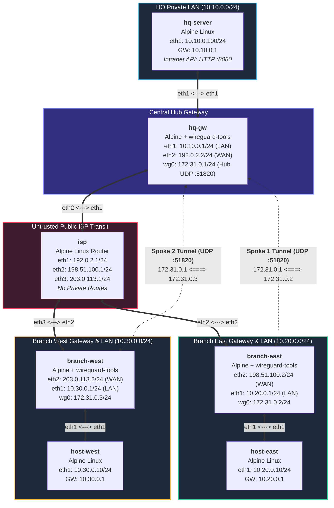

# Lab Assignment: Multi-Site Hub-and-Spoke WireGuard VPN in Containerlab

## Overview & Objectives

The objective of this lab is to design, deploy, and verify a **Hub-and-Spoke WireGuard VPN** using **Containerlab**. Unlike a simple point-to-point tunnel between two sites, enterprise networks frequently connect multiple remote branch offices (`Branch East` and `Branch West`) back to a central headquarters gateway (`hq-gw`) across an untrusted public internet transit router (`isp`). 

Your primary task is to configure a single WireGuard interface (`wg0`) on the central Hub (`hq-gw`) with **multiple peers**, establish tunnels from both remote Spokes (`branch-east` and `branch-west`), configure inter-site static routing so branches can communicate *through* the Hub, and enforce Cryptokey Routing (`AllowedIPs`) policies.

---

## 1. Network Topology & IP Allocation

The complete topology below uses three pre-generated Curve25519 keypairs so all tunnels establish handshakes immediately upon deployment:

* **`hq-gw` (Hub):**
  * **Private Key:** `yI3JXo/7F0ofNjyJsXbHklEst4yZN4/AiJJ4Xmtaok0=`
  * **Public Key:** `Ix3WRdpj7EWXOjv9JjSiAMVJSgGucEC/2ewjqsYMVhE=`
* **`branch-east` (Spoke 1):**
  * **Private Key:** `yK2TEOIUH9ZVtxm3aPKNqqV2T5VLszSSXfgL9ids30Q=`
  * **Public Key:** `xlVbQyIZXZ/azpUgJDYJodxHJKw3u0Gl7AeFrH3O1S8=`
* **`branch-west` (Spoke 2):**
  * **Private Key:** `4H1p+R8uK0m2N5v8X1z4B7d0G3j6M9p2S5v8Y1b4E1w=`
  * **Public Key:** `n8K2p5S8v1Y4b7E0h3K6n9Q2t5W8z1C4f7I0l3O6r9A=`

*(Note: Alternatively, students can generate fresh keypairs via `apt install wireguard && wg genkey | tee private.key | wg pubkey > public.key`.)*

Use the diagram below to configure your Containerlab node interfaces, WireGuard tunnel endpoints, and subnet assignments across the HQ (`10.10.0.0/24`), Branch East (`10.20.0.0/24`), Branch West (`10.30.0.0/24`), Tunnel (`172.31.0.0/24`), and Public WAN (`192.0.2.0/24`, `198.51.100.0/24`, `203.0.113.0/24`) networks.



> **Host Prerequisite:** Ensure the `wireguard` kernel module is loaded on your Containerlab host machine prior to deployment (`sudo modprobe wireguard`).

---

## 2. Repository Directory Structure

Ensure your local repository matches the following structure before submitting:

```text
wireguard-hub-spoke-lab/
├── README.md
└── lab.clab.yml
```

---

## 3. Configuration & Topology Skeleton

### A. Containerlab Skeleton Topology (`lab.clab.yml`)

Complete the skeleton YAML below by configuring:
1. **Transit Router (`isp`):** IP addresses across all three WAN interfaces and IPv4 packet forwarding.
2. **Central Hub (`hq-gw`):** LAN/WAN interfaces, IPv4 forwarding, a single `wg0` interface (`172.31.0.1/24` on UDP port `51820`) peered with **both** `branch-east` (`AllowedIPs: 172.31.0.2/32,10.20.0.0/24`) and `branch-west` (`AllowedIPs: 172.31.0.3/32,10.30.0.0/24`), and static routes to both branch subnets via `wg0`.
3. **Spoke Gateways (`branch-east` & `branch-west`):** LAN/WAN interfaces, IPv4 forwarding, `wg0` interfaces (`172.31.0.2/24` and `172.31.0.3/24`) peered with `hq-gw` (`endpoint 192.0.2.2:51820`), and static routes so each branch can reach both HQ (`10.10.0.0/24`) and the opposite branch (`10.30.0.0/24` or `10.20.0.0/24`) through `wg0`. *(Hint: Ensure `hq-gw` is included in each spoke's `AllowedIPs` for both HQ and the remote spoke subnet!)*
4. **End Hosts (`hq-server`, `host-east`, `host-west`):** LAN IP addressing, default routes, and an HTTP server on `hq-server:8080` serving `/tmp/status.json` containing `{"hub":"hq-server","vpn":"operational"}`.

```yaml
name: wg-hub-spoke

topology:
  nodes:
    isp:
      kind: linux
      image: alpine:latest
      exec:
        - apk add --no-cache tcpdump iproute2
        # TODO: Configure eth1 (192.0.2.1/24), eth2 (198.51.100.1/24), eth3 (203.0.113.1/24), and enable IPv4 forwarding

    hq-gw:
      kind: linux
      image: alpine:latest
      exec:
        - apk add --no-cache wireguard-tools tcpdump iproute2
        # TODO: Configure eth1 (10.10.0.1/24), eth2 (192.0.2.2/24), default route via 192.0.2.1, and IPv4 forwarding
        # TODO: Create wg0 (172.31.0.1/24) on UDP port 51820 and configure BOTH branch-east and branch-west peers
        # TODO: Add static routes for 10.20.0.0/24 and 10.30.0.0/24 via wg0

    branch-east:
      kind: linux
      image: alpine:latest
      exec:
        - apk add --no-cache wireguard-tools tcpdump iproute2
        # TODO: Configure eth1 (10.20.0.1/24), eth2 (198.51.100.2/24), default route via 198.51.100.1, and IPv4 forwarding
        # TODO: Create wg0 (172.31.0.2/24) and peer with hq-gw (192.0.2.2:51820) allowing 172.31.0.0/24, 10.10.0.0/24, and 10.30.0.0/24
        # TODO: Add static routes for HQ (10.10.0.0/24) and Branch West (10.30.0.0/24) via wg0

    branch-west:
      kind: linux
      image: alpine:latest
      exec:
        - apk add --no-cache wireguard-tools tcpdump iproute2
        # TODO: Configure eth1 (10.30.0.1/24), eth2 (203.0.113.2/24), default route via 203.0.113.1, and IPv4 forwarding
        # TODO: Create wg0 (172.31.0.3/24) and peer with hq-gw (192.0.2.2:51820) allowing 172.31.0.0/24, 10.10.0.0/24, and 10.20.0.0/24
        # TODO: Add static routes for HQ (10.10.0.0/24) and Branch East (10.20.0.0/24) via wg0

    hq-server:
      kind: linux
      image: alpine:latest
      exec:
        - apk add --no-cache curl python3 tcpdump iproute2
        # TODO: Configure eth1 (10.10.0.100/24) and default route via 10.10.0.1
        # TODO: Create /tmp/status.json with '{"hub":"hq-server","vpn":"operational"}' and start HTTP server on port 8080

    host-east:
      kind: linux
      image: alpine:latest
      exec:
        - apk add --no-cache curl tcpdump iproute2
        # TODO: Configure eth1 (10.20.0.10/24) and default route via 10.20.0.1

    host-west:
      kind: linux
      image: alpine:latest
      exec:
        - apk add --no-cache curl tcpdump iproute2
        # TODO: Configure eth1 (10.30.0.10/24) and default route via 10.30.0.1

  links:
    - endpoints: ["hq-server:eth1", "hq-gw:eth1"]
    - endpoints: ["hq-gw:eth2", "isp:eth1"]
    - endpoints: ["isp:eth2", "branch-east:eth2"]
    - endpoints: ["isp:eth3", "branch-west:eth2"]
    - endpoints: ["branch-east:eth1", "host-east:eth1"]
    - endpoints: ["branch-west:eth1", "host-west:eth1"]
```

---

## 4. Lab Validation & Testing Log

Execute the following 5 evaluation commands against your deployed Containerlab topology and verify that your output matches the expected results.

### Test 1: Multi-Peer Hub Handshake Verification (`hq-gw`)
Verify that the central Hub (`hq-gw`) has a single active `wg0` interface on UDP port `51820` with **two** distinct authenticated peers (`branch-east` and `branch-west`) showing recent cryptographic handshakes.

```bash
docker exec -it clab-wg-hub-spoke-hq-gw wg show
```
* **Expected Output:** Displays `interface: wg0` on `listening port: 51820` with two separate `peer:` blocks—one for `198.51.100.2:51820` (`allowed ips: 172.31.0.2/32, 10.20.0.0/24`) and one for `203.0.113.2:51820` (`allowed ips: 172.31.0.3/32, 10.30.0.0/24`)—both reporting a `latest handshake` timestamp.

### Test 2: Spoke-to-Hub Application Access (`host-east` to `hq-server`)
Verify that a client in Branch East (`10.20.0.10`) can retrieve the internal HTTP status payload hosted at HQ (`10.10.0.100:8080`) over the encrypted tunnel.

```bash
docker exec -it clab-wg-hub-spoke-host-east curl -i -s http://10.10.0.100:8080/status.json
```
* **Expected Output:** `HTTP/1.0 200 OK` response containing `{"hub":"hq-server","vpn":"operational"}`.

### Test 3: Hub-and-Spoke Inter-Branch Routing (`host-east` to `host-west`)
Verify that traffic from Branch East (`10.20.0.10`) to Branch West (`10.30.0.10`) is routed into the WireGuard overlay, decrypted by `hq-gw`, re-encrypted toward `branch-west`, and delivered successfully.

```bash
docker exec -it clab-wg-hub-spoke-host-east ping -c 4 10.30.0.10
```
* **Expected Output:** `4 packets transmitted, 4 packets received, 0% packet loss`

### Test 4: Tunnel Overlay Hop Verification (`traceroute` Across VPN)
Verify that packets traveling from `host-west` (`10.30.0.10`) to `hq-server` (`10.10.0.100`) traverse the WireGuard tunnel IP (`172.31.0.1`) rather than exposing public ISP router hops (`192.0.2.1` / `203.0.113.1`).

```bash
docker exec -it clab-wg-hub-spoke-host-west traceroute -n -w 1 10.10.0.100
```
* **Expected Output:** Shows 3 hops: `10.30.0.1` (`branch-west`), `172.31.0.1` (`hq-gw` tunnel interface), and `10.10.0.100` (`hq-server`), with **zero** public ISP IP addresses visible.

### Test 5: Cryptokey Routing Isolation (`AllowedIPs` Spoof Drop Test)
Verify that `hq-gw` enforces strict source-IP validation via `AllowedIPs` by dropping packets sourced from an unauthorized subnet (`10.99.0.10/24`) injected on `host-west`.

```bash
docker exec -it clab-wg-hub-spoke-host-west sh -c "ip addr add 10.99.0.10/24 dev eth1 && ping -c 2 -W 1 -I 10.99.0.10 10.10.0.100"
```
* **Expected Output:** `2 packets transmitted, 0 packets received, 100% packet loss`

---

## 5. Marking Rubric

This lab is graded out of a total of **100 points**. Work is evaluated based on repository completeness, topology configuration, and command-line validation outcomes.

| Category | Requirement / Description | Weight | Points |
| :--- | :--- | :---: | :---: |
| **Repository & Topology Setup** | • Clean repository structure containing `README.md` and a valid `lab.clab.yml`.<br>• Proper IP addressing and forwarding across `isp`, `hq-gw`, `branch-east`, `branch-west`, and all three LAN hosts. | **20%** | **20 pts** |
| **Test Outcome 1: Multi-Peer Hub Handshake** | • `hq-gw` operates a single `wg0` interface (`172.31.0.1/24`) with active handshakes to both `branch-east` and `branch-west`. | **20%** | **20 pts** |
| **Test Outcome 2: Spoke-to-Hub HTTP Access** | • `host-east` successfully retrieves `http://10.10.0.100:8080/status.json` (`HTTP 200 OK`) across the encrypted tunnel. | **20%** | **20 pts** |
| **Test Outcome 3 & 4: Inter-Branch & Overlay Routing** | • Bidirectional ICMP connectivity between `host-east` and `host-west` via `hq-gw` (`0%` loss).<br>• `traceroute` confirms packets traverse `172.31.0.1` without exposing ISP hops. | **20%** | **20 pts** |
| **Test Outcome 5: Cryptokey Routing Enforcement** | • Unauthorized source subnet (`10.99.0.10/24`) is dropped (`100%` loss) by WireGuard's `AllowedIPs` policy. | **20%** | **20 pts** |
| **Total** | | **100%** | **100 pts** |
