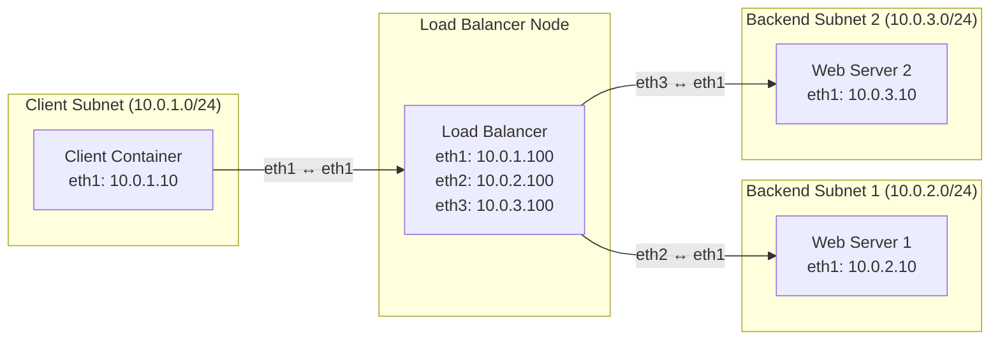

# Application-Layer Round-Robin Load Balancing with Nginx

## 1. Objectives & Background

### Why Load Balancing?
In modern network architecture, relying on a single web server introduces a critical **Single Point of Failure (SPOF)**. If that server crashes or experiences high traffic congestion, application availability drops to zero. 

To achieve **High Availability (HA)** and scalability, system architects deploy a cluster of backend web servers fronted by a **Reverse Proxy / Load Balancer**. The load balancer acts as the single point of entry for clients, distributing incoming requests across multiple backend nodes. If one backend server goes down, the load balancer can route traffic solely to the healthy remaining nodes, ensuring uninterrupted service.

### Round-Robin Scheduling
One of the simplest and most common traffic distribution algorithms is **Round-Robin**. In this scheme, requests are distributed sequentially across the pool of backend servers:
1. Request 1 $\rightarrow$ Backend Server 1
2. Request 2 $\rightarrow$ Backend Server 2
3. Request 3 $\rightarrow$ Backend Server 1
4. Request 4 $\rightarrow$ Backend Server 2

---

## 2. Network Topology & IP Addressing

The lab environment consists of four distinct containers: a client, an Nginx load balancer (`lb`), and two backend web servers (`web1`, `web2`). The load balancer acts as a multi-homed gateway bridging three separate subnets.



### Interface & Subnet Summary
* **Client to Load Balancer Link:** 
  * `client` (`eth1`): `10.0.1.10/24`
  * `lb` (`eth1`): `10.0.1.100/24`
* **Load Balancer to Web Server 1 Link:** 
  * `lb` (`eth2`): `10.0.2.100/24`
  * `web1` (`eth1`): `10.0.2.10/24`
* **Load Balancer to Web Server 2 Link:** 
  * `lb` (`eth3`): `10.0.3.100/24`
  * `web2` (`eth1`): `10.0.3.10/24`

---

## 3. Understanding Containerlab File Binds

By default, container filesystems are ephemeral—any configuration changes made inside a running container are lost when the container is destroyed. Containerlab allows you to use **bind mounts** (`binds:`) to map files and directories from your host machine directly into specific container file paths at startup. This allows you to persist configurations, serve custom web pages, or inject custom Nginx setups.

### Example: Binding the Nginx Configuration
To inject a custom Nginx configuration file (`nginx.conf`) from your host's `configs/` directory into the load balancer container's Nginx configuration path (`/etc/nginx/nginx.conf`), you specify a bind mount inside the `lb` node definition using read-only (`:ro`) permissions:

```yaml
nodes:
  lb:
    kind: linux
    image: nginx:alpine
    binds:
      - configs/nginx.conf:/etc/nginx/nginx.conf:ro
```

### Example: Binding Custom HTML Files for Web Servers
Similarly, to customize the default landing page for each web server so you can visually verify which backend handled a request, you can map local HTML files to Nginx's default web root directory (`/usr/share/nginx/html/index.html`):

```yaml
nodes:
  web1:
    kind: linux
    image: nginx:alpine
    binds:
      - configs/web1.html:/usr/share/nginx/html/index.html:ro
  web2:
    kind: linux
    image: nginx:alpine
    binds:
      - configs/web2.html:/usr/share/nginx/html/index.html:ro
```

---

## 4. Lab Assignment Instructions

Your task is to write a complete Containerlab topology YAML file from scratch that fulfills the topology and addressing schema outlined in Section 2. 

1. Create a working directory and a subfolder named `configs/`.
2. Write your `configs/nginx.conf`, `configs/web1.html`, and `configs/web2.html` files.
3. Write your Containerlab topology YAML file utilizing proper node types (`kind: linux`), images (`alpine:latest` and `nginx:alpine`), node-level `exec` commands to configure IP addresses/bring up interfaces, explicit link definitions, and file binds.
4. Deploy your lab using `containerlab deploy`.

---

## 5. Verification & Testing

Once your lab is successfully deployed, run the following test command from inside the client container to verify round-robin distribution:

```bash
docker exec -it clab-<your-lab-name>-client sh -c 'for i in $(seq 1 4); do wget -qO- http://10.0.1.100; echo ""; done'
```

### Expected Output
Your terminal output must alternate sequentially between the two backend servers:

```text
<h1>Response from Backend Server 1 (web1)</h1>
<h1>Response from Backend Server 2 (web2)</h1>
<h1>Response from Backend Server 1 (web1)</h1>
<h1>Response from Backend Server 2 (web2)</h1>
```

---

## 6. Assessment & Marking Rubric

| Criteria | Weight | Description & Requirements |
| :--- | :---: | :--- |
| **Topology YAML Implementation** | **50%** | • Correctly defines all 4 nodes (`client`, `lb`, `web1`, `web2`) with appropriate container images (`alpine:latest`, `nginx:alpine`).<br>• Correctly specifies the 3 point-to-point links matching the network diagram.<br>• Utilizes node-level `exec` blocks to correctly assign IP addresses and bring up interfaces (`ip addr add` and `ip link set up`) across all nodes. |
| **File Binds Configuration** | **20%** | • Correctly configures the `binds:` directive on the `lb` node to mount `nginx.conf` to `/etc/nginx/nginx.conf`.<br>• Correctly configures the `binds:` directive on `web1` and `web2` to mount custom HTML files to their respective web root paths. |
| **Nginx Load Balancer Configuration** | **30%** | • Implements a working `upstream` block in `nginx.conf` pointing to `10.0.2.10` and `10.0.3.10`.<br>• Configures a server block listening on port 80 with `proxy_pass` set to the upstream cluster.<br>• Successfully produces the exact alternating output when executing the test command script from the client container. |