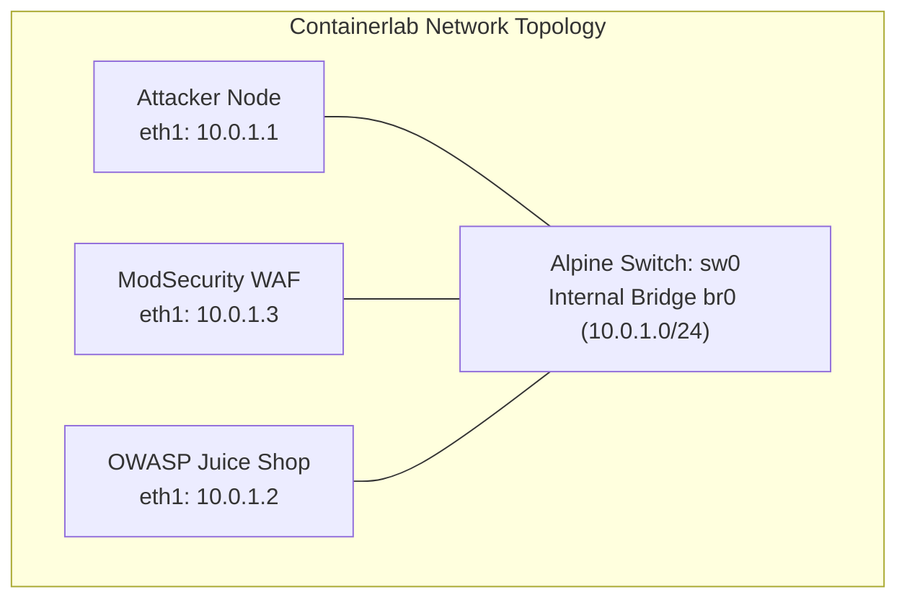

# L7 WAF Security with ModSecurity and Containerlab

In this tutorial, you will learn how to configure a Layer 7 (L7) Web Application Firewall (WAF) using ModSecurity and NGINX inside a **Containerlab** environment. We will deploy the intentionally vulnerable **OWASP Juice Shop** application behind our ModSecurity WAF reverse proxy and launch attacks from a dedicated **Attacker** container using `curl`.

By the end of this lab, you will understand:

1. How to define multi-node topologies connected via an Alpine container acting as a Layer 2 switch.

2. The core syntax and anatomy of ModSecurity rules.

3. How to mount custom ModSecurity rules into a WAF container.

4. How to build custom container images locally to support network utilities (`iproute2`) in minimal application containers.

5. How to verify protection by running attacks using explicit IP addresses over a shared Layer 2 domain.

---

## 1. Lab Architecture

The topology connects all nodes to an Alpine Linux bridge container (`sw0`). This establishes a unified Layer 2 broadcast domain so ARP resolution and IP routing work reliably across all containers without relying on host-level bridges or facing veth timeouts.

* **Switch Node (`sw0`):** Alpine Linux container running an internal `br0` bridge interface.

* **Attacker Node (`attacker`):** Attached via `eth1` (`10.0.1.1/24`).

* **OWASP Juice Shop (`juiceshop`):** Attached via `eth1` (`10.0.1.2/24`).

* **ModSecurity WAF Proxy (`waf`):** Attached via `eth1` (`10.0.1.3/24`).



---

## 2. Understanding ModSecurity Rule Syntax

ModSecurity rules follow a structured format:

```
SecRule DIRECTIVE "OPERATOR" "ACTIONS"
```

### Anatomy of a Rule:

1. **Variables (`DIRECTIVE`):** Defines *where* ModSecurity should look in the HTTP request or response.
   * `REQUEST_URI`: The URI requested by the client.
   * `ARGS`: Query string arguments and POST parameters.
   * `REQUEST_HEADERS`: HTTP headers sent by the client.

2. **Operators (`OPERATOR`):** Defines *what* to search for (starts with `@`).
   * `@rx`: Regular expression match.
   * `@contains`: Simple substring match.
   * `@streq`: Exact string equality match.

3. **Actions (`ACTIONS`):** Defines *what to do* if the rule triggers.
   * `id`: Unique numeric identifier for the rule (mandatory).
   * `phase`: Execution phase (e.g., `phase:1` = Request Headers, `phase:2` = Request Body).
   * `deny`: Block the request immediately.
   * `status:403`: Return an HTTP 403 Forbidden status code.
   * `log`: Log the event to the audit log.
   * `msg`: A custom message describing the rule match.

---

## 3. Directory Structure & File Setup

Create a project directory on your lab host:

```bash
mkdir -p modsec-lab/rules
cd modsec-lab
```

### Step 3.1: Create Custom ModSecurity Rules File

Create `rules/custom_rules.conf`:

```ini
# Enable ModSecurity Engine
SecRuleEngine On

# Request Body Processing
SecRequestBodyAccess On
SecResponseBodyAccess Off

# Custom Rule 1: Block SQL Injection in Query/Body Parameters
SecRule ARGS "@rx (?i)(union\s+select|select\s+.*\s+from|drop\s+table|' OR '1'='1)" \
    "id:100001,\
    phase:2,\
    deny,\
    status:403,\
    log,\
    msg:'Custom Rule: SQL Injection Attempt Blocked'"

# Custom Rule 2: Block Specific Malicious User-Agent
SecRule REQUEST_HEADERS:User-Agent "@contains attack-tool" \
    "id:100003,\
    phase:1,\
    deny,\
    status:403,\
    log,\
    msg:'Custom Rule: Malicious User-Agent Detected'"
```

### Step 3.2: Create a Custom Dockerfile for Juice Shop

Because Containerlab does not support a `build` property directly inside node definitions, you must build custom images locally using Docker. 

Create a directory for the Dockerfiles for the `modsec` and `juiceshop` images.

```bash
mkdir -P images/modsec
mkdir -P images/juiceshop
```

Create a `images/juiceshop/Dockerfile` in your lab directory:

```dockerfile
FROM node:24-trixie

USER root

RUN apt-get update && apt-get install -y --no-install-recommends \
    bash \
    iproute2 \
    iputils-ping \
    tcpdump \
    git \
    python3 \
    make \
    g++ \
    && rm -rf /var/lib/apt/lists/*

WORKDIR /juice-shop

RUN git clone --depth 1 \
    https://github.com/juice-shop/juice-shop.git .

RUN npm install

EXPOSE 3000

CMD ["npm", "start"]
```

Build the image:

```bash
cd images/juiceshop
docker build -t custom-juiceshop:latest .
cd ../../
```

Create a `images/modsec/Dockerfile` in your lab directory:

```dockerfile
FROM owasp/modsecurity-crs:nginx

USER root

RUN apt-get update \
    && apt-get install -y --no-install-recommends iproute2 iputils-ping \
    && rm -rf /var/lib/apt/lists/*
```

Build the image:

```bash
cd images/modsec
docker build -t custom-waf:latest .
cd ../../
```

### Step 3.3: Create Containerlab Topology (`lab.clab.yaml`)

Create `lab.clab.yaml` in the root of `modsec-lab/`:

```yaml
name: modsec-l7-lab

topology:
  nodes:
    # 1. Alpine Container functioning as a Layer 2 Switch
    sw0:
      kind: linux
      image: alpine:latest
      exec:
        - apk add --no-cache iproute2 bridge-utils
        - ip link add br0 type bridge
        - ip link set dev br0 up
        - ip link set dev eth1 master br0
        - ip link set dev eth2 master br0
        - ip link set dev eth3 master br0
        - ip link set dev eth1 up
        - ip link set dev eth2 up
        - ip link set dev eth3 up

    # 2. Dedicated Attacker Node
    attacker:
      kind: linux
      image: alpine:latest
      exec:
        - apk add --no-cache curl bash
        - ip link set dev eth1 up        
        - ip addr add 10.0.1.1/24 dev eth1

    # 3. Target Application: Custom Juice Shop with iproute2 pre-installed
    juiceshop:
      kind: linux
      image: custom-juiceshop:latest
      ports:
        - "3000:3000"
      exec:
        - ip link set dev eth1 up
        - ip addr add 10.0.1.2/24 dev eth1

    # 4. Layer 7 WAF Proxy: OWASP ModSecurity Core Rule Set container
    waf:
      kind: linux
      image: custom-waf:latest
      ports:
        - "80:8080"
      env:
        BACKEND: "http://10.0.1.2:3000"
        MODSEC_RULE_ENGINE: "On"
      binds:
        # Mount custom rules into the ModSecurity additional rules directory
        - rules/custom_rules.conf:/etc/modsecurity.d/owasp-crs/rules/RESPONSE-999-CUSTOM.conf:ro
      exec:
        - ip link set dev eth1 up      
        - ip addr add 10.0.1.3/24 dev eth1

  # Inter-container Links through Switch (sw0)
  links:
    - endpoints: ["attacker:eth1", "sw0:eth1"]
    - endpoints: ["waf:eth1", "sw0:eth2"]
    - endpoints: ["juiceshop:eth1", "sw0:eth3"]
```

---

## 4. Deploying the Containerlab Environment

Run the following command to deploy the topology:

```bash
sudo clab deploy -t lab.clab.yaml
```

Containerlab will instantiate the nodes, attach them to the Alpine `sw0` switch container, and configure the bridge for seamless Layer 2 switching across the `10.0.1.0/24` subnet.

---

## 5. Verification & Testing

Execute test commands directly from the `attacker` container using `docker exec` targeting explicit IP addresses across the switched network.

### Step 5.1: Verify Basic Connectivity

Verify that the `attacker` can resolve ARP and reach both nodes over switch `sw0`:

```bash
docker exec -it clab-modsec-l7-lab-attacker ping -c 2 10.0.1.2
docker exec -it clab-modsec-l7-lab-attacker ping -c 2 10.0.1.3
```

### Test 1: Direct Access to Vulnerable Application (Bypassing WAF)

Execute an SQL injection payload directly against the Juice Shop interface IP (`10.0.1.2:3000`):

```bash
docker exec -it clab-modsec-l7-lab-attacker curl -i "http://10.0.1.2:3000/rest/products/search?q=apple'))%20OR%201=1--"
```

#### Expected Output:
The application responds directly with **`HTTP/1.1 200 OK`**:

```http
HTTP/1.1 200 OK
Access-Control-Allow-Origin: *
Content-Type: application/json; charset=utf-8
...

{"status":"success","data":[...]}
```

### Test 2: Request via ModSecurity WAF Proxy (Blocked with 403)

Send the exact same SQL injection payload targeting the WAF interface IP (`10.0.1.3:8080`):

```bash
docker exec -it clab-modsec-l7-lab-attacker curl -i "http://10.0.1.3:8080/rest/products/search?q=apple'))%20OR%201=1--"
```

#### Expected Output:
ModSecurity inspects the `q` query argument, triggers Rule `100001`, and blocks the request with **`HTTP/1.1 403 Forbidden`**:

```http
HTTP/1.1 403 Forbidden
Server: nginx
Date: Thu, 29 Oct 2026 12:00:00 GMT
Content-Type: text/html
Content-Length: 146
Connection: keep-alive

<html>
<head><title>403 Forbidden</title></head>
<body>
<center><h1>403 Forbidden</h1></center>
<hr><center>nginx</center>
</body>
</html>
```

### Test 3: Malicious User-Agent Block via WAF

Test custom Rule `100003` by sending a request containing the forbidden User-Agent header to the WAF IP (`10.0.1.3:8080`):

```bash
docker exec -it clab-modsec-l7-lab-attacker curl -i -s -H "User-Agent: attack-tool/v1.0" http://10.0.1.3:8080/
```

#### Expected Output:

```http
HTTP/1.1 403 Forbidden
```

---

## 6. Inspecting ModSecurity Audit Logs

To view detailed logs of blocked requests inside the WAF container:

```bash
docker logs -f clab-modsec-l7-lab-waf
```

---

## 7. Cleanup

To tear down the lab environment and remove all inter-container links:

```bash
sudo clab destroy -t lab.clab.yaml
```
