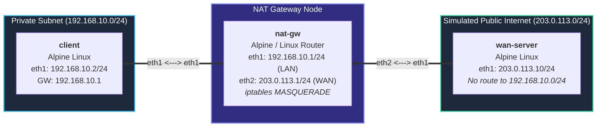

# Understanding NAT Gateways 

## 1. What is a NAT Gateway?

A **Network Address Translation (NAT) Gateway** is a networking device, service, or router function that modifies network address information in IP packet headers while they are in transit across a traffic routing device. 

Specifically, a NAT Gateway allows devices within a **private network** (using non-routable private IP addresses defined in RFC 1918, such as `10.0.0.0/8`, `172.16.0.0/12`, or `192.168.0.0/16`) to initiate outbound connections to external networks (like the public internet) using a single, or a small pool of, **public IP addresses**.

### How It Works (PAT / Masquerading)
Most modern NAT Gateways perform **Port Address Translation (PAT)**, often referred to in Linux networking as **IP Masquerading**:
1. **Outbound Request:** A private host (`192.168.10.2`) sends a packet to an external server (`8.8.8.8`) from a random ephemeral source port (e.g., `54321`).
2. **Translation & State Tracking:** The NAT Gateway intercepts the packet, records the mapping (`192.168.10.2:54321` $\leftrightarrow$ `203.0.113.1:40001`) in its **connection tracking (conntrack) table**, and rewrites the packet's source IP and source port to its own public interface IP (`203.0.113.1`) and a newly allocated port (`40001`).
3. **Inbound Reply:** When the external server replies to `203.0.113.1:40001`, the NAT Gateway consults its conntrack table, rewrites the destination back to `192.168.10.2:54321`, and forwards it into the private network.

---

## 2. Why Are NAT Gateways Used in Networking?

* **IPv4 Address Conservation:** The global pool of public IPv4 addresses is exhausted. NAT enables thousands of internal hosts to share a single public IP address.
* **Security & Network Isolation:** Because NAT Gateways maintain stateful translation tables, unsolicited inbound traffic from the internet cannot be routed to internal hosts unless an explicit translation rule (like DNAT / Port Forwarding) exists. Internal topology remains hidden.
* **Decoupling Internal Architecture:** Organizations can re-architect, expand, or re-number their internal private IP subnets without needing to request new public IP blocks from their ISP or cloud provider.
* **Cloud Egress Control:** In cloud environments (AWS, GCP, Azure), managed NAT Gateways provide a static, predictable egress IP address for private subnets, making it easy to whitelist traffic on third-party partner firewalls.

---

## 3. Containerlab Tutorial: Building a NAT Gateway Lab

In this tutorial, we will use **Containerlab** to deploy a multi-node topology consisting of a private client, a Linux-based NAT Gateway router, and a simulated external/WAN server.

### Architectural Topology Diagram



> **Note on Routing:** Notice that `wan-server` has **no static route** back to `192.168.10.0/24`. This accurately mimics the real internet—if packets arrive at `wan-server` without being translated by `nat-gw`, `wan-server` will drop the return traffic because private IPs are unroutable on the WAN.

---

### Step 1: Create the Containerlab Topology File

Create a directory for your lab and save the following configuration as `nat-lab.clab.yml`:

```yaml
name: nat-lab

topology:
  nodes:
    client:
      kind: linux
      image: alpine:latest
      exec:
        - ip addr add 192.168.10.2/24 dev eth1
        - ip route replace default via 192.168.10.1 dev eth1            
        - apk add --no-cache curl tcpdump iproute2

    nat-gw:
      kind: linux
      image: alpine:latest
      exec:
        # Configure LAN and WAN interfaces
        - ip addr add 192.168.10.1/24 dev eth1
        - ip addr add 203.0.113.1/24 dev eth2
        # Enable IPv4 packet forwarding
        - sysctl -w net.ipv4.ip_forward=1
        # Install networking & firewall tools
        - apk add --no-cache iptables tcpdump conntrack-tools iproute2
        # Configure NAT (Masquerade) on the WAN interface (eth2)
        - iptables -t nat -A POSTROUTING -o eth2 -j MASQUERADE

    wan-server:
      kind: linux
      image: alpine:latest
      exec:
        - ip addr add 203.0.113.10/24 dev eth1
        # Intentionally DO NOT add a route to 192.168.10.0/24
        - apk add --no-cache python3 tcpdump iproute2

  links:
    - endpoints: ["client:eth1", "nat-gw:eth1"]
    - endpoints: ["nat-gw:eth2", "wan-server:eth1"]
```

### Step 2: Deploy the Lab

Run the following command in the directory containing your `nat-lab.clab.yml` file:

```bash
sudo containerlab deploy -t nat-lab.clab.yml
```

Once deployed, start a simple HTTP server on `wan-server` so we have a service to test against:

```bash
docker exec -d clab-nat-lab-wan-server python3 -m http.server 8080
```

---

## 4. Observing How NAT Gateways Affect Networks

Use the following commands across the three containers to inspect packet headers, translation tables, and routing behavior in real time.

### Experiment 1: Verify Connectivity & Source IP Translation

1. **Start a packet capture on `wan-server`** to see what IP address external servers observe when `client` connects:
   ```bash
   docker exec -it clab-nat-lab-wan-server tcpdump -i eth1 -nn port 8080
   ```

2. **Open a second terminal** and make an HTTP request from `client` (`192.168.10.2`) to `wan-server` (`203.0.113.10`):
   ```bash
   docker exec -it clab-nat-lab-client curl -I http://203.0.113.10:8080
   ```

3. **Observe the `tcpdump` output on `wan-server`:**
   ```text
   15:20:01.123456 IP 203.0.113.1.48290 > 203.0.113.10.8080: Flags [S], seq 123456...
   ```
   *Observation:* Even though the request originated from `192.168.10.2`, `wan-server` sees the traffic coming from **`203.0.113.1`** (the NAT Gateway's WAN IP).

---

### Experiment 2: Inspect the NAT Translation & Conntrack Tables

While generating traffic (or immediately after running `curl`), inspect the active translations on the `nat-gw` node.

1. **View active connection tracking entries:**
   ```bash
   docker exec -it clab-nat-lab-nat-gw conntrack -L
   ```
   *Example Output:*
   ```text
   tcp      6 118 TIME_WAIT src=192.168.10.2 dst=203.0.113.10 sport=51422 dport=8080 src=203.0.113.10 dst=203.0.113.1 sport=8080 dport=51422 [ASSURED] mark=0 use=1
   ```
   *Observation:* Notice how the tuple tracks both the original direction (`src=192.168.10.2 dst=203.0.113.10`) and the expected reply direction (`src=203.0.113.10 dst=203.0.113.1`).

2. **Check `iptables` NAT rule hit counters:**
   ```bash
   docker exec -it clab-nat-lab-nat-gw iptables -t nat -L -v -n
   ```
   *Observation:* Look at the `pkts` and `bytes` columns under `Chain POSTROUTING` to see how many new sessions triggered the `MASQUERADE` rule. (Note: `POSTROUTING` counters only increment on the *first* packet of a new connection; subsequent packets in the same flow are handled automatically by `conntrack`).

---

### Experiment 3: Observe What Happens *Without* NAT

To prove why NAT is necessary when the external network lacks private subnet routes, temporarily flush the NAT rule and test connectivity.

1. **Flush the NAT table on `nat-gw`:**
   ```bash
   docker exec -it clab-nat-lab-nat-gw iptables -t nat -F
   ```

2. **Start `tcpdump` on `wan-server` again (filtering for ICMP):**
   ```bash
   docker exec -it clab-nat-lab-wan-server tcpdump -i eth1 -nn icmp
   ```

3. **Ping `wan-server` from `client` (in a second terminal):**
   ```bash
   docker exec -it clab-nat-lab-client ping -c 3 203.0.113.10
   ```

4. **Observe the failure:**
   * On `client`, the ping will hang with **100% packet loss**.
   * On `wan-server`, `tcpdump` will show:
     ```text
     15:25:10.001122 IP 192.168.10.2 > 203.0.113.10: ICMP echo request, id 12, seq 1
     ```
   * *Why did it fail?* `nat-gw` still routed the packet forward (`ip_forward=1`), so the echo request reached `wan-server` with its raw private IP (`192.168.10.2`). However, `wan-server` has no route to `192.168.10.0/24` and drops the reply!

5. **Restore the NAT rule:**
   ```bash
   docker exec -it clab-nat-lab-nat-gw iptables -t nat -A POSTROUTING -o eth2 -j MASQUERADE
   ```

---

### Experiment 4: Verify Stateful Inbound Protection

Try initiating a connection in the reverse direction—from `wan-server` to `client`:

```bash
docker exec -it clab-nat-lab-wan-server ping -c 2 192.168.10.2
```
*Observation:* `Network is unreachable` (or dropped at the gateway if routed). Because there is no existing entry in `conntrack` and no static DNAT rule, internal nodes are shielded from unsolicited external traffic.

---

## 5. Clean Up

When you are finished experimenting, destroy the Containerlab topology to clean up all containers and virtual network interfaces:

```bash
sudo containerlab destroy -t nat-lab.clab.yml --cleanup
```
