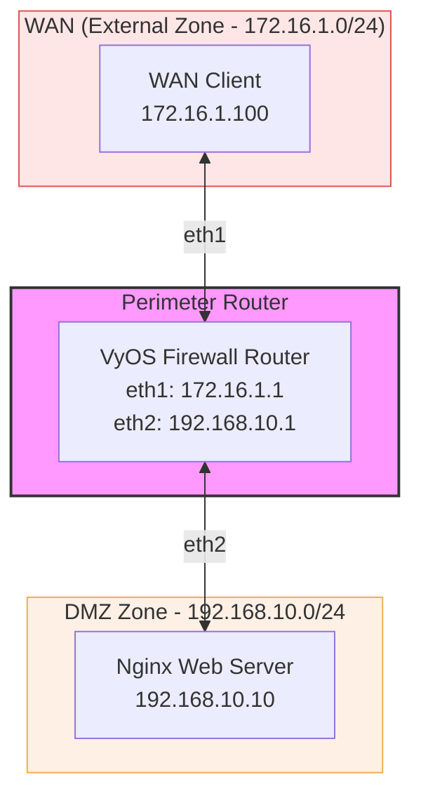

# VyOS Firewall Tutorial: Port 22 Restriction & Configuration Mounting

This tutorial guides you through creating a Containerlab network lab with VyOS as a firewall router. In this scenario, we focus on mounting initial configuration files for both the web server and VyOS router, and configuring a firewall rule set that **allows all traffic across the network except SSH (TCP port 22)**.

---

## 1. Architecture Diagram

The architecture consists of an external WAN client, a central VyOS firewall router, and a DMZ network containing an Nginx web server.



---

## 2. Directory Structure & File Mount Setup

To mount initial configurations into the VyOS firewall and Nginx web server, structure your workspace as follows before launching the lab:

```text
.
├── config/
│   ├── vyos.config         # Initial VyOS configuration script
│   └── index.html          # Custom HTML page for Nginx
├── lab.clab.yml            # Containerlab topology file
└── tutorial.md             # Documentation
```

### Creating Local Mounted Files

1. **Create the HTML file (`config/index.html`):**
   ```html
   <!DOCTYPE html>
   <html>
   <head><title>DMZ Web Server</title></head>
   <body>
       <h1>Welcome to the Protected DMZ Web Server!</h1>
   </body>
   </html>
   ```

2. **Create the initial VyOS configuration file (`config/vyos.config`):**
   ```text
   set interfaces ethernet eth1 address 172.16.1.1/24
   set interfaces ethernet eth2 address 192.168.10.1/24
   
   set firewall name BLOCK_SSH default-action accept
   set firewall name BLOCK_SSH rule 10 action drop
   set firewall name BLOCK_SSH rule 10 protocol tcp
   set firewall name BLOCK_SSH rule 10 destination port 22
   set firewall name BLOCK_SSH rule 10 description "Block incoming SSH access"

   set interfaces ethernet eth1 firewall in name BLOCK_SSH
   ```

---

## 3. Containerlab Topology File (`lab.clab.yml`)

This YAML configuration defines nodes, IP settings, interfaces, and binds local host files into the container paths.

```yaml
name: vyos-port22-lab

topology:
  nodes:
    # VyOS Firewall Router
    vyos:
      kind: vyos
      image: vyos/vyos:1.4-rolling-202310100317
      cmd: /sbin/init
      binds:
        - config/vyos.config:/opt/vyatta/etc/config/scripts/vyos-postconfig-bootup.script

    # Nginx DMZ Web Server
    dmz-server:
      kind: linux
      image: nginx:alpine
      binds:
        - config/index.html:/usr/share/nginx/html/index.html:ro
      exec:
        - ip addr add 192.168.10.10/24 dev eth1
        - ip route add default via 192.168.10.1 dev eth1

    # External WAN Client
    wan-client:
      kind: linux
      image: alpine:latest
      exec:
        - apk add --no-cache curl netcat-openbsd
        - ip addr add 172.16.1.100/24 dev eth1
        - ip route add default via 172.16.1.1 dev eth1

  links:
    - endpoints: ["vyos:eth1", "wan-client:eth1"]
    - endpoints: ["vyos:eth2", "dmz-server:eth1"]
```

---

## 4. VyOS Firewall Commands Explained

If you choose to set up or modify the firewall rules manually via the command line, run `configure` and execute the commands below.

### Command Breakdown

1. **Set Default Policy to Accept All Traffic**
   ```bash
   set firewall name BLOCK_SSH default-action accept
   ```
   * `set firewall name BLOCK_SSH`: Creates or targets a firewall rule set named `BLOCK_SSH`.
   * `default-action accept`: Instructs the firewall to permit any traffic that does not explicitly match an active rule in this set.

2. **Define Rule 10 to Drop TCP Port 22 (SSH)**
   ```bash
   set firewall name BLOCK_SSH rule 10 action drop
   set firewall name BLOCK_SSH rule 10 protocol tcp
   set firewall name BLOCK_SSH rule 10 destination port 22
   set firewall name BLOCK_SSH rule 10 description "Block incoming SSH access"
   ```
   * `rule 10`: Designates the rule sequence index. Lower numbers are evaluated first.
   * `action drop`: Silently discards packets matching this rule.
   * `protocol tcp`: Restricts rule evaluation to Transmission Control Protocol (TCP) traffic.
   * `destination port 22`: Targets traffic bound for port 22 (SSH).
   * `description ...`: Adds documentation visible in `show firewall`.

3. **Bind Rule Set to the Interface**
   ```bash
   set interfaces ethernet eth1 firewall in name BLOCK_SSH
   ```
   * `set interfaces ethernet eth1`: Selects external interface `eth1`.
   * `firewall in`: Applies the firewall ruleset to incoming traffic entering interface `eth1` before routing decisions occur.
   * `name BLOCK_SSH`: Specifies `BLOCK_SSH` as the rule set to execute on this interface.

4. **Commit and Save Configuration**
   ```bash
   commit
   save
   ```
   * `commit`: Applies changes to the active running configuration.
   * `save`: Persists configuration changes across reboot cycles.

---

## 5. Verification & Testing

Deploy the lab:
```bash
sudo clab deploy -t lab.clab.yml
```

### Test 1: Verify Port 80 (HTTP Traffic Allowed)

Execute an HTTP GET request from `wan-client` to `dmz-server`:

```bash
docker exec -it clab-vyos-port22-lab-wan-client curl -s http://192.168.10.10
```

**Expected Result:**
```html
<!DOCTYPE html>
<html>
<head><title>DMZ Web Server</title></head>
<body>
    <h1>Welcome to the Protected DMZ Web Server!</h1>
</body>
</html>
```
*Why?* The default action for the `BLOCK_SSH` rule set is `accept`, and port 80 does not match rule 10.

---

### Test 2: Verify Port 22 (SSH Traffic Blocked)

Probe TCP port 22 from `wan-client` to `dmz-server`:

```bash
docker exec -it clab-vyos-port22-lab-wan-client nc -zv -w 3 192.168.10.10 22
```

**Expected Result:**
```text
nc: connect to 192.168.10.10 port 22 (tcp) timed out
```
*Why?* Rule 10 explicitly drops incoming TCP packets destined for port 22.

---

### Test 3: Verify ICMP Ping Traffic (Allowed)

Ping the DMZ server from `wan-client`:

```bash
docker exec -it clab-vyos-port22-lab-wan-client ping -c 3 192.168.10.10
```

**Expected Result:**
```text
3 packets transmitted, 3 received, 0% packet loss
```
*Why?* ICMP traffic is not port 22 TCP traffic, so it passes under the default `accept` action.