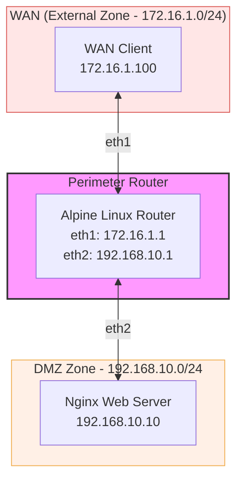

# Linux Firewall Tutorial: Port 22 Restriction & Configuration Mounting

This tutorial guides you through creating a Containerlab network lab with an Alpine Linux firewall router using `iptables`. In this scenario, we focus on mounting initial configuration files for both the web server and router, setting up stateful packet filtering, overriding default management routes to prevent packet loss, and configuring a firewall rule set that **allows all traffic across the network except SSH (TCP port 22)**.

---

## 1. Architecture Diagram

The architecture consists of an external WAN client, a central Alpine Linux firewall router, and a DMZ network containing an Nginx web server.



---

## 2. Directory Structure & File Mount Setup

To mount initial configurations into the firewall router and Nginx web server, structure your workspace as follows before launching the lab:

```text
.
├── config/
│   ├── iptables.rules      # Stateful iptables configuration rules
│   └── index.html          # Custom HTML page for Nginx
├── physical-firewall.yml   # Containerlab topology file
└── tutorial.md             # Documentation
```

### Creating Local Mounted Files

1. **Create the HTML file (`config/index.html`):**
   ```html
   <!DOCTYPE html>
   <html>
   <head><title>DMZ Web Server</title></head>
   <body>
       <h1>Welcome to the Protected DMZ Web Server!</h1>
   </body>
   </html>
   ```

2. **Create the `iptables` configuration file (`config/iptables.rules`):**
   ```text
   *filter
   :INPUT ACCEPT [0:0]
   :FORWARD ACCEPT [0:0]
   :OUTPUT ACCEPT [0:0]

   # 1. Allow established and related packets to return freely
   -A INPUT -m state --state ESTABLISHED,RELATED -j ACCEPT
   -A FORWARD -m state --state ESTABLISHED,RELATED -j ACCEPT

   # 2. Explicitly allow new traffic from WAN (eth1) to DMZ (eth2)
   -A FORWARD -i eth1 -o eth2 -m state --state NEW -j ACCEPT

   # 3. Block incoming SSH access on the WAN interface
   -A INPUT -i eth1 -p tcp --dport 22 -j DROP
   -A FORWARD -i eth1 -p tcp --dport 22 -j DROP

   COMMIT
   ```

---

## 3. Containerlab Topology File (`physical-firewall.yml`)

This YAML configuration defines nodes, IP settings, interfaces, binds host files, and overrides default management routing on client nodes to eliminate packet loss.

```yaml
name: physical-firewall

topology:
  nodes:
    # Alpine Linux Firewall Router
    router:
      kind: linux
      image: alpine:latest
      binds:
        - config/iptables.rules:/etc/iptables.rules
      exec:
        - apk add --no-cache iptables
        - sysctl -w net.ipv4.ip_forward=1
        - ip addr replace 172.16.1.1/24 dev eth1
        - ip addr replace 192.168.10.1/24 dev eth2
        - iptables-restore < /etc/iptables.rules

    # Nginx DMZ Web Server
    dmz-server:
      kind: linux
      image: nginx:alpine
      binds:
        - config/index.html:/usr/share/nginx/html/index.html:ro
      exec:
        - ip addr add 192.168.10.10/24 dev eth1
        - ip route replace default via 192.168.10.1 dev eth1        

    # External WAN Client
    wan-client:
      kind: linux
      image: alpine:latest
      exec:
        - apk add --no-cache curl netcat-openbsd
        - ip addr add 172.16.1.100/24 dev eth1
        - ip route replace default via 172.16.1.1 dev eth1

  links:
    - endpoints: ["router:eth1", "wan-client:eth1"]
    - endpoints: ["router:eth2", "dmz-server:eth1"]
```

---

## 4. Key Networking Fixes & Commands Explained

### Preventing Packet Loss (Default Gateway Cleanup)
By default, Docker/Containerlab attaches `eth0` to a management network bridge (`172.20.20.0/24`). Without deleting the management default route (`ip route del default || true`), containers route external traffic (like `192.168.10.10`) out `eth0` to the host system instead of `eth1` to the firewall router.

### Understanding the Stateful `iptables` Rules

1. **Stateful Session Tracking (`ESTABLISHED,RELATED`)**
   ```text
   -A FORWARD -m state --state ESTABLISHED,RELATED -j ACCEPT
   ```
   Ensures return packets for TCP streams or ICMP echoes originating from the DMZ or WAN client are automatically matched and forwarded.

2. **Allowing `NEW` Connections Across Zones**
   ```text
   -A FORWARD -i eth1 -o eth2 -m state --state NEW -j ACCEPT
   ```
   Permits initial handshake packets (`SYN`) entering on `eth1` and routed out to `eth2` so that web traffic (HTTP) can initiate cleanly.

3. **Restricting SSH (Port 22)**
   ```text
   -A FORWARD -i eth1 -p tcp --dport 22 -j DROP
   ```
   Explicitly drops any packet inbound from interface `eth1` attempting to initiate a TCP session on destination port 22.

---

## 5. Verification & Testing

Deploy the lab:
```bash
sudo containerlab deploy -t physical-firewall.yml
```

### Test 1: Verify Port 80 (HTTP Traffic Allowed)

Execute an HTTP GET request from `wan-client` to `dmz-server`:

```bash
docker exec -it clab-physical-firewall-wan-client curl -s http://192.168.10.10
```

**Expected Result:**
```html
<!DOCTYPE html>
<html>
<head><title>DMZ Web Server</title></head>
<body>
    <h1>Welcome to the Protected DMZ Web Server!</h1>
</body>
</html>
```

---

### Test 2: Verify Port 22 (SSH Traffic Blocked)

Probe TCP port 22 from `wan-client` to `dmz-server`:

```bash
docker exec -it clab-physical-firewall-wan-client nc -zv -w 3 192.168.10.10 22
```

**Expected Result:**
```text
nc: connect to 192.168.10.10 port 22 (tcp) timed out
```

---

### Test 3: Verify ICMP Ping Traffic (Allowed without Loss)

Ping the DMZ server from `wan-client`:

```bash
docker exec -it clab-physical-firewall-wan-client ping -c 3 192.168.10.10
```

**Expected Result:**
```text
3 packets transmitted, 3 received, 0% packet loss
```

---

## 6. Verifying IPTables Configuration & Troubleshooting Silent Failures

When launching container routers, `iptables-restore` can silently fail if syntax formatting is off, required kernel modules aren't loaded on the host, or `exec` scripts run before the `iptables` binary has finished installing via package manager.

### Step 6.1: Inspecting Active Firewall Rules inside the Container

To verify which rules are actively running on the router container, inspect the rule chains directly:

```bash
# Check the main filter table (INPUT, FORWARD, OUTPUT) with packet/byte counters
docker exec -it clab-physical-firewall-router iptables -L -v -n --line-numbers

# Check the NAT table (if using SNAT/DNAT/MASQUERADE)
docker exec -it clab-physical-firewall-router iptables -t nat -L -v -n --line-numbers
```

**Key Parameters:**
* `-L`: Lists the rules in the selected table.
* `-v` (Verbose): Displays interface names (`in`, `out`) and packet/byte counters. Increasing counters confirm traffic is matching the rule.
* `-n` (Numeric): Prints IP addresses and port numbers in numerical format to avoid slow DNS lookup delays.
* `--line-numbers`: Adds rule position numbers, which helps if you need to delete (`iptables -D`) or insert (`iptables -I`) specific rules.

---

### Step 6.2: Diagnosing `iptables-restore` Failures

If running `iptables -L -v -n` displays empty default policies despite mounting `iptables.rules`, run a dry-run test to diagnose syntax or parsing errors:

```bash
# Test rule file syntax without applying changes
docker exec -it clab-physical-firewall-router iptables-restore --test /etc/iptables.rules

# Manually re-run the restore command to inspect stderr output and exit status
docker exec -it clab-physical-firewall-router sh -c "iptables-restore < /etc/iptables.rules; echo Exit Code: $?"
```

*If the exit code is non-zero, check the terminal output for the line number where parsing failed.*

---

### Step 6.3: Manual CLI Configuration (Fallback Setup)

If file mounting or automated restoration fails, you can manually build the firewall policy via direct CLI commands using `docker exec`:

```bash
# 1. Enable IPv4 packet forwarding in kernel
docker exec -it clab-physical-firewall-router sysctl -w net.ipv4.ip_forward=1

# 2. Flush existing rules and custom chains across all tables
docker exec -it clab-physical-firewall-router iptables -F
docker exec -it clab-physical-firewall-router iptables -t nat -F
docker exec -it clab-physical-firewall-router iptables -X

# 3. Set default chain policies
docker exec -it clab-physical-firewall-router iptables -P INPUT ACCEPT
docker exec -it clab-physical-firewall-router iptables -P FORWARD ACCEPT
docker exec -it clab-physical-firewall-router iptables -P OUTPUT ACCEPT

# 4. Allow stateful established and related traffic
docker exec -it clab-physical-firewall-router iptables -A INPUT -m state --state ESTABLISHED,RELATED -j ACCEPT
docker exec -it clab-physical-firewall-router iptables -A FORWARD -m state --state ESTABLISHED,RELATED -j ACCEPT

# 5. Allow new connections from WAN (eth1) to DMZ (eth2)
docker exec -it clab-physical-firewall-router iptables -A FORWARD -i eth1 -o eth2 -m state --state NEW -j ACCEPT

# 6. Block incoming SSH traffic on port 22 on WAN interface
docker exec -it clab-physical-firewall-router iptables -A INPUT -i eth1 -p tcp --dport 22 -j DROP
docker exec -it clab-physical-firewall-router iptables -A FORWARD -i eth1 -p tcp --dport 22 -j DROP
```

Once manually configured, save the live rules to your rule file:

```bash
docker exec -it clab-physical-firewall-router sh -c "iptables-save > /etc/iptables.rules"
```
