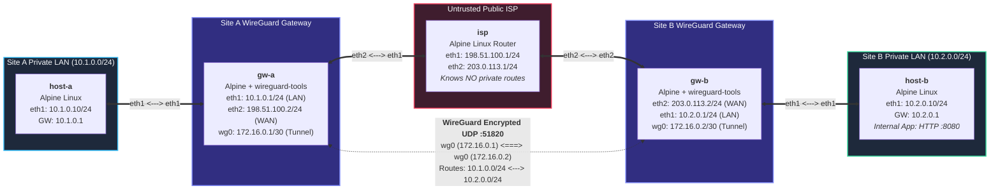
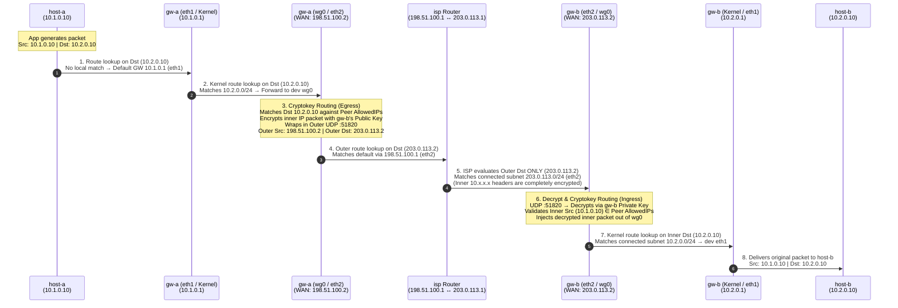

# Understanding VPNs & Implementing a WireGuard Site-to-Site Tunnel in Containerlab

## 1. What is a VPN and How Does WireGuard Differ?

A **Virtual Private Network (VPN)** extends a private network across a public or untrusted network (such as the internet), encapsulating and encrypting traffic so that remote hosts or branch offices can communicate securely.

### Why WireGuard?

While traditional protocols like **IPsec** rely on complex negotiation daemons (IKEv2) and kernel XFRM security policies, **WireGuard** is a modern, high-performance VPN protocol built directly into the Linux kernel that treats VPN tunnels as simple virtual network interfaces (`wg0`):

* **Minimalist Cryptography:** Uses opinionated, state-of-the-art primitives (ChaCha20 for encryption, Poly1305 for authentication, Curve25519 for key exchange, and BLAKE2s for hashing) with zero cipher-suite negotiation.
* **Cryptokey Routing:** Associates public keys directly with allowed IP subnets (`AllowedIPs`). If a packet arrives from a peer, its source IP must match that peer's `AllowedIPs`; if a packet is routed out `wg0`, its destination IP determines which peer's public key encrypts it.
* **Stateless & Stealthy:** Operates over standard UDP (default port `51820`) and remains completely silent unless a peer sends a packet authenticated with a valid public key.

### Modern Use Cases for WireGuard

* **Site-to-Site Branch & Cloud Peering:** Linking office LANs and cloud VPCs using standard Linux routing tables (`ip route`) rather than policy-based IPsec selectors.
* **Zero-Trust Mesh Networks:** Powers modern overlay networks (such as Tailscale and Netmaker) for peer-to-peer connectivity across NATs and firewalls.
* **High-Throughput Remote Access:** Ideal for mobile clients due to seamless roaming—if a client switches from Wi-Fi to cellular, the tunnel persists without renegotiation.

---

## 2. Lab Architecture: Site-to-Site WireGuard VPN

In this tutorial, we will deploy a 5-node topology in **Containerlab** connecting two private branch LANs (`Site A` and `Site B`) across an untrusted ISP router (`isp`). Unlike IPsec, each gateway creates a dedicated Layer 3 virtual interface (`wg0`) and uses standard static IP routes to direct traffic into the tunnel.

### Architectural Topology Diagram



> **Prerequisites Note:** Because Docker containers share the host Linux kernel, ensure the `wireguard` kernel module is loaded on your Containerlab host machine before deploying (`sudo modprobe wireguard`).

---

## 3. End-to-End Packet Walkthrough (`host-a` $\rightarrow$ `host-b`)

Understanding how a packet moves from `host-a` (`10.1.0.10`) to `host-b` (`10.2.0.10`) reveals how standard Linux IP routing and WireGuard's **Cryptokey Routing** work together without NAT or complex IPsec policies.

### Packet Traversal Sequence Diagram



### Step-by-Step IP Evaluation & Packet Transformation

1. **`host-a` (Originating Host Routing):**
   * **Packet Headers:** `Src: 10.1.0.10` | `Dst: 10.2.0.10`
   * **IP Evaluated:** **Destination IP (`10.2.0.10`)**.
   * **How it's evaluated:** `host-a` checks its routing table for `10.2.0.10`. Because it is not in its local subnet (`10.1.0.0/24`), it falls back to its default route (`default via 10.1.0.1 dev eth1`), resolves `10.1.0.1`'s MAC address via ARP, and transmits the frame to `gw-a`.

2. **`gw-a` (Kernel Forwarding & Tunnel Interface Selection):**
   * **Packet Headers:** `Src: 10.1.0.10` | `Dst: 10.2.0.10`
   * **IP Evaluated:** **Destination IP (`10.2.0.10`)**.
   * **How it's evaluated:** `gw-a` receives the packet on `eth1`. Since `net.ipv4.ip_forward=1` is enabled, the Linux kernel performs a routing table lookup on `10.2.0.10`. It finds the static route `10.2.0.0/24 dev wg0` and hands the unencrypted IP packet directly to the virtual `wg0` interface. *(Note: Notice that `wg0`'s own tunnel IP `172.16.0.1` is not even needed as a next-hop IP because `wg0` is a Layer 3 point-to-multipoint interface).*

3. **`gw-a` (`wg0` Cryptokey Routing & UDP Encapsulation):**
   * **Inner Packet (Encrypted Payload):** `Src: 10.1.0.10` | `Dst: 10.2.0.10`
   * **Outer Packet (Clear-Text Transport):** `Src: 198.51.100.2:51820` | `Dst: 203.0.113.2:51820` (UDP)
   * **IPs Evaluated:** **Inner Destination IP (`10.2.0.10`)** and **Outer Destination IP (`203.0.113.2`)**.
   * **How they're evaluated:**
     * **Cryptokey Lookup:** Inside `wg0`, WireGuard inspects the **Inner Destination IP (`10.2.0.10`)** and compares it against the `AllowedIPs` configured for every peer. It matches `10.2.0.0/24` on `gw-b`'s peer entry.
     * **Encryption & Encapsulation:** WireGuard encrypts the entire original IP packet using ChaCha20-Poly1305 with the session key derived from `gw-b`'s public key, prepends a WireGuard transport header, and wraps it in a new UDP datagram destined for `gw-b`'s configured `endpoint` (`203.0.113.2:51820`).
     * **Outer Routing:** The Linux kernel now routes this *new* outer packet by evaluating the **Outer Destination IP (`203.0.113.2`)**, matching `default via 198.51.100.1 dev eth2`.

4. **`isp` (Untrusted Transit Router):**
   * **Outer Packet Headers:** `Src: 198.51.100.2:51820` | `Dst: 203.0.113.2:51820`
   * **IP Evaluated:** **Outer Destination IP (`203.0.113.2`)**.
   * **How it's evaluated:** The ISP router has **zero routes** for `10.1.0.0/24` or `10.2.0.0/24` and cannot inspect them because they are encrypted inside the UDP payload. It only evaluates `203.0.113.2`, sees that it belongs to its directly connected subnet `203.0.113.0/24` on `eth2`, and forwards the UDP packet to `gw-b`.

5. **`gw-b` (Decryption & Ingress Cryptokey Validation):**
   * **Outer Packet Received:** `Src: 198.51.100.2:51820` | `Dst: 203.0.113.2:51820`
   * **Inner Packet Extracted:** `Src: 10.1.0.10` | `Dst: 10.2.0.10`
   * **IPs Evaluated:** **Outer Destination Port (`UDP/51820`)** and **Inner Source IP (`10.1.0.10`)**.
   * **How they're evaluated:**
     * **Decryption:** `gw-b` receives the UDP packet on `eth2:51820`. The kernel WireGuard module identifies the sender via the WireGuard receiver index, verifies the Poly1305 authentication tag, and decrypts the payload.
     * **Reverse-Path Cryptokey Check (Anti-Spoofing):** Once decrypted, WireGuard inspects the **Inner Source IP (`10.1.0.10`)** and verifies that it is permitted by `gw-a`'s `AllowedIPs` (`172.16.0.1/32, 10.1.0.0/24`). Because `10.1.0.10` matches `10.1.0.0/24`, the packet is accepted and emerges from `wg0` as a normal decapsulated IP packet. *(If `10.1.0.10` were not in `AllowedIPs`, `gw-b` would silently drop it here).*

6. **`gw-b` to `host-b` (Local LAN Delivery):**
   * **Packet Headers:** `Src: 10.1.0.10` | `Dst: 10.2.0.10`
   * **IP Evaluated:** **Inner Destination IP (`10.2.0.10`)**.
   * **How it's evaluated:** Now that the original packet has exited `wg0` in plaintext, `gw-b`'s kernel routes it using the **Destination IP (`10.2.0.10`)**. It matches the directly connected route `10.2.0.0/24 dev eth1` and delivers the packet over the Site B LAN to `host-b`. To `host-b`, the packet appears to have arrived directly from `10.1.0.10` without any NAT modification.

---

## 4. Containerlab Topology & WireGuard Configuration

Because WireGuard configurations are short and self-contained, we can configure everything directly inside a single Containerlab YAML file (`wg-lab.clab.yml`).

### Important: Key Pair Consistency, `keys` Directory Setup, and Redeploying

Hardcoding static key pairs across multiple `exec` blocks in a topology YAML can easily introduce key mismatches or silent packet drops if a peer public key does not match its counterpart's active private key. Keep these lessons in mind:

1. **Create a `keys` Directory (Not a File):** When bind-mounting a shared key directory (such as `./keys:/tmp/keys`) so nodes generate and read `.key` and `.pub` files automatically, **create a directory (`mkdir -p keys`)**, not a regular file. Creating a file named `keys` on the host beforehand will cause Docker/Containerlab bind-mounting into `/tmp/keys` to fail. Multiple key files (`gw-a.key`, `gw-a.pub`, `gw-b.key`, `gw-b.pub`) live inside that directory.
2. **Derive Public Keys From Private Keys (Single Source of Truth):** Generate each node's Curve25519 private key and derive its public key directly with `wg genkey` and `wg pubkey`—either dynamically at startup into a shared `./keys` bind mount or via a helper script/`Makefile`—so public and private keys cannot drift out of sync.
3. **Always Pass `--reconfigure` When Updating Keys or `exec` Steps:** If you modify keys or `exec` commands in your YAML and redeploy an existing lab, run `sudo containerlab deploy -t wg-lab.clab.yml --reconfigure` so `exec` steps re-run on the nodes instead of leaving stale keys active in running containers. (To rotate keys cleanly, clear `./keys/*` and deploy with `--reconfigure`.)
4. **Verify Handshakes and Byte Counters Before Debugging Routing:** If traffic experiences 100% packet loss, check `wg show` on each gateway first. A mismatched or stale key shows **no recent handshake** and **`0 B received`** even when keepalives or pings are being sent.

### Step 1: Create the `keys` Directory and Topology File (`wg-lab.clab.yml`)

Create a lab directory and a **`keys` directory** (`mkdir -p wg-lab/keys && cd wg-lab`), then save the following configuration as `wg-lab.clab.yml` (using dynamic key generation via `./keys:/tmp/keys` so each node's public key is derived directly from its own private key):

```yaml
name: wg-lab

topology:
  nodes:
    isp:
      kind: linux
      image: alpine:latest
      exec:
        - apk add --no-cache tcpdump iproute2      
        - ip addr add 198.51.100.1/24 dev eth1
        - ip addr add 203.0.113.1/24 dev eth2
        - sysctl -w net.ipv4.ip_forward=1

    gw-a:
      kind: linux
      image: alpine:latest
      binds:
        - ./keys:/tmp/keys
      exec:
        - apk add --no-cache wireguard-tools tcpdump iproute2

        # 1. Configure LAN, WAN, and default route
        - ip addr add 10.1.0.1/24 dev eth1
        - ip addr add 198.51.100.2/24 dev eth2
        - ip route replace default via 198.51.100.1
        - sysctl -w net.ipv4.ip_forward=1

        # 2. Generate gw-a key pair if missing and wait for gw-b public key
        - mkdir -p /tmp/keys
        - sh -c '[ -f /tmp/keys/gw-a.key ] || (wg genkey > /tmp/keys/gw-a.key && wg pubkey < /tmp/keys/gw-a.key > /tmp/keys/gw-a.pub)'
        - sh -c 'i=0; while [ ! -s /tmp/keys/gw-b.pub ] && [ $i -lt 50 ]; do sleep 0.2; i=$((i+1)); done'

        # 3. Create and configure the WireGuard interface (wg0)
        - ip link add dev wg0 type wireguard
        - ip addr add 172.16.0.1/30 dev wg0
        - wg set wg0 listen-port 51820 private-key /tmp/keys/gw-a.key
        - sh -c 'wg set wg0 peer "$(cat /tmp/keys/gw-b.pub)" allowed-ips 172.16.0.2/32,10.2.0.0/24 endpoint 203.0.113.2:51820 persistent-keepalive 15'
        - ip link set up dev wg0

        # 4. Route Site B's subnet into the WireGuard interface
        - ip route add 10.2.0.0/24 dev wg0

    gw-b:
      kind: linux
      image: alpine:latest
      binds:
        - ./keys:/tmp/keys
      exec:
        - apk add --no-cache wireguard-tools tcpdump iproute2

        # 1. Configure LAN, WAN, and default route
        - ip addr add 10.2.0.1/24 dev eth1
        - ip addr add 203.0.113.2/24 dev eth2
        - ip route replace default via 203.0.113.1
        - sysctl -w net.ipv4.ip_forward=1

        # 2. Generate gw-b key pair if missing and wait for gw-a public key
        - mkdir -p /tmp/keys
        - sh -c '[ -f /tmp/keys/gw-b.key ] || (wg genkey > /tmp/keys/gw-b.key && wg pubkey < /tmp/keys/gw-b.key > /tmp/keys/gw-b.pub)'
        - sh -c 'i=0; while [ ! -s /tmp/keys/gw-a.pub ] && [ $i -lt 50 ]; do sleep 0.2; i=$((i+1)); done'

        # 3. Create and configure the WireGuard interface (wg0)
        - ip link add dev wg0 type wireguard
        - ip addr add 172.16.0.2/30 dev wg0
        - wg set wg0 listen-port 51820 private-key /tmp/keys/gw-b.key
        - sh -c 'wg set wg0 peer "$(cat /tmp/keys/gw-a.pub)" allowed-ips 172.16.0.1/32,10.1.0.0/24 endpoint 198.51.100.2:51820 persistent-keepalive 15'
        - ip link set up dev wg0

        # 4. Route Site A's subnet into the WireGuard interface
        - ip route add 10.1.0.0/24 dev wg0

    host-a:
      kind: linux
      image: alpine:latest
      exec:
        - apk add --no-cache curl tcpdump iproute2      
        - ip addr add 10.1.0.10/24 dev eth1
        - ip route replace default via 10.1.0.1

    host-b:
      kind: linux
      image: alpine:latest
      exec:
        - apk add --no-cache curl python3 tcpdump iproute2
        - ip addr add 10.2.0.10/24 dev eth1
        - ip route replace default via 10.2.0.1
        - sh -c "echo 'CONFIDENTIAL_WIREGUARD_PAYLOAD' > /tmp/secret.txt && nohup python3 -m http.server 8080 --bind 0.0.0.0 -d /tmp >/tmp/http.log 2>&1 &"

  links:
    - endpoints: ["host-a:eth1", "gw-a:eth1"]
    - endpoints: ["gw-a:eth2", "isp:eth1"]
    - endpoints: ["isp:eth2", "gw-b:eth2"]
    - endpoints: ["gw-b:eth1", "host-b:eth1"]
```

### Step 2: Deploy (or Redeploy) the Topology

Ensure the `keys` directory exists before deploying (`mkdir -p keys`), load the `wireguard` kernel module, and deploy with `--reconfigure` whenever updating keys or `exec` blocks:

```bash
mkdir -p keys
sudo modprobe wireguard
sudo containerlab deploy -t wg-lab.clab.yml --reconfigure
```

---

## 5. Testing VPN Connectivity & Application Traffic

### 1. Inspect WireGuard Interface & Handshake Status

Run `wg show` on `gw-a` (and `gw-b`) to confirm the active public keys match, a `latest handshake` timestamp is present, and `received` bytes are non-zero:

```bash
docker exec -it clab-wg-lab-gw-a wg show
```

*Expected Output:*
```text
interface: wg0
  public key: <gw-a-generated-public-key>
  private key: (hidden)
  listening port: 51820

peer: <gw-b-generated-public-key>
  endpoint: 203.0.113.2:51820
  allowed ips: 172.16.0.2/32, 10.2.0.0/24
  latest handshake: 12 seconds ago
  transfer: 1.24 KiB received, 1.48 KiB sent
  persistent keepalive: every 15 seconds
```

### 2. Check the Routing Table on the Gateway

Notice how clean WireGuard routing is compared to IPsec—traffic for `10.2.0.0/24` is simply routed out the `wg0` interface:

```bash
docker exec -it clab-wg-lab-gw-a ip route
```

*Expected Output Snippet:*
```text
default via 198.51.100.1 dev eth2
10.1.0.0/24 dev eth1 scope link src 10.1.0.1
10.2.0.0/24 dev wg0 scope link
172.16.0.0/30 dev wg0 scope link src 172.16.0.1
198.51.100.0/24 dev eth2 scope link src 198.51.100.2
```

### 3. Test End-to-End Ping & Application Traffic

1. **Ping `host-b` (`10.2.0.10`) from `host-a` (`10.1.0.10`):**
   ```bash
   docker exec -it clab-wg-lab-host-a ping -c 4 10.2.0.10
   ```

2. **Query the internal HTTP application on `host-b` across the tunnel:**
   ```bash
   docker exec -it clab-wg-lab-host-a curl http://10.2.0.10:8080/secret.txt
   ```
   *Expected Output:*
   ```text
   CONFIDENTIAL_WIREGUARD_PAYLOAD
   ```

---

## 6. Observing WireGuard Encryption Across the Network

Because WireGuard creates a real virtual network interface (`wg0`), you can observe both the **unencrypted inner IP packets** entering `wg0` and the **ChaCha20-Poly1305 encrypted UDP packets** leaving `eth2` on the exact same router!

### 1. Capture Unencrypted Inner Packets on `wg0` (`gw-a`)

Run `tcpdump` directly on the virtual `wg0` interface of `gw-a`:

```bash
docker exec -it clab-wg-lab-gw-a tcpdump -i wg0 -nn -A port 8080
```

Trigger `curl http://10.2.0.10:8080/secret.txt` from `host-a` in another terminal. Because `wg0` sits *before* encryption on egress (and *after* decryption on ingress), you will see the raw private IPs (`10.1.0.10` $\rightarrow$ `10.2.0.10`) and the plaintext string `CONFIDENTIAL_WIREGUARD_PAYLOAD`.


```bash
docker exec -it clab-wg-lab-host-a curl http://10.2.0.10:8080/secret.txt
```

*Example Output on `gw-a`:*
```text
listening on wg0, link-type RAW (Raw IP), snapshot length 262144 bytes
16:17:40.273905 IP 10.1.0.10.48226 > 10.2.0.10.8080: Flags [S], seq 3896811808, win 56760, options [mss 9460,sackOK,TS val 3432533096 ecr 0,nop,wscale 10], length 0
E..<..@.?.>.
..

..
.b...D. ..............$....
..Lh.......

16:17:40.274217 IP 10.2.0.10.8080 > 10.1.0.10.48226: Flags [S.], seq 849914565, ack 3896811809, win 56688, options [mss 9460,sackOK,TS val 1400566937 ecr 3432533096,nop,wscale 10], length 0
E..<..@.?.'.
..

..
...b2....D.!...p.I....$....
Sz....Lh...

16:17:40.274240 IP 10.1.0.10.48226 > 10.2.0.10.8080: Flags [.], ack 1, win 56, options [nop,nop,TS val 3432533096 ecr 1400566937], length 0
E..4..@.?.?.
..

..
.b...D.!2......8.......
..LhSz..
16:17:40.274303 IP 10.1.0.10.48226 > 10.2.0.10.8080: Flags [P.], seq 1:89, ack 1, win 56, options [nop,nop,TS val 3432533096 ecr 1400566937], length 88: HTTP: GET /secret.txt HTTP/1.1
E.....@.?.>.
..

..
.b...D.!2......8.......
..LhSz..GET /secret.txt HTTP/1.1
Host: 10.2.0.10:8080
User-Agent: curl/8.23.0
Accept: */*


16:17:40.274642 IP 10.2.0.10.8080 > 10.1.0.10.48226: Flags [.], ack 89, win 56, options [nop,nop,TS val 1400566937 ecr 3432533096], length 0
E..4..@.?.q*
..

..
...b2....D.y...8.9.....
Sz....Lh
16:17:40.275148 IP 10.2.0.10.8080 > 10.1.0.10.48226: Flags [P.], seq 1:188, ack 89, win 56, options [nop,nop,TS val 1400566938 ecr 3432533096], length 187: HTTP: HTTP/1.0 200 OK
E.....@.?.pn
..

..
...b2....D.y...8J......
Sz....LhHTTP/1.0 200 OK
Server: SimpleHTTP/0.6 Python/3.14.10
Date: Sat, 21 Nov 2026 16:17:40 GMT
Content-type: text/plain
Content-Length: 31
Last-Modified: Sat, 21 Nov 2026 16:15:07 GMT
```

### 2. Capture Encrypted WireGuard UDP Packets on the ISP (`isp`)

Now run `tcpdump` on the untrusted `isp` router:

```bash
docker exec -it clab-wg-lab-isp tcpdump -i eth1 -nn -X udp port 51820
```

Trigger `curl http://10.2.0.10:8080/secret.txt` from `host-a` again.

```bash
docker exec -it clab-wg-lab-host-a curl http://10.2.0.10:8080/secret.txt
```

*Example Output on `isp`:*
```text
16:42:08.119204 IP 198.51.100.2.51820 > 203.0.113.2.51820: UDP, length 160
        0x0000:  4500 00bc 3a12 0000 3f11 e108 c633 6402  E...:...?....3d.
        0x0010:  cb00 7102 ca6c ca6c 00a8 841b 0400 0000  ..q..l.l........
        0x0020:  8a2f 1900 0000 0000 9f4c 2b8e 71d0 44a1  ./.......L+.q.D.
        0x0030:  e318 77c9 02b4 66f1 5a89 12d4 88e0 31c7  ..w...f.Z.....1.
```

*What to observe:*
* **Standard UDP Transport:** Unlike IPsec (which uses IP Protocol 50 / ESP), WireGuard encapsulates everything inside standard **UDP port 51820** packets between `198.51.100.2` and `203.0.113.2`, making it highly compatible with NAT devices and cloud load balancers.
* **WireGuard Message Type Header:** Look at byte `0x001c` (`0400 0000`). In the WireGuard protocol specification, type `0x04` indicates an encrypted **Transport Data** message, followed by the 4-byte receiver index (`8a2f 1900`) and 8-byte nonce counter (`0000 0000`).
* **Authenticated Ciphertext:** Everything from `0x0028` onward is encrypted with ChaCha20 and authenticated with a 16-byte Poly1305 MAC tag—completely hiding the inner HTTP request and private IP headers.

### 3. Verify Cryptokey Routing Enforcement (`AllowedIPs`)

You can test WireGuard's built-in **Cryptokey Routing** security by attempting to send traffic from an unauthorized source IP across the tunnel.

1. Add a secondary, unauthorized IP address (`10.99.99.10/24`) to `host-a` and route it toward `gw-a`:
   ```bash
   docker exec -it clab-wg-lab-host-a ip addr add 10.99.99.10/24 dev eth1
   ```
2. Try pinging `host-b` sourcing from that unauthorized IP:
   ```bash
   docker exec -it clab-wg-lab-host-a ping -c 2 -I 10.99.99.10 10.2.0.10
   ```
3. **Observe the drop:** `gw-a` immediately drops the packet before it ever leaves `wg0` because `10.99.99.10` is not listed in `gw-b`'s `AllowedIPs` (`172.16.0.2/32, 10.2.0.0/24`). Even if `gw-a` were misconfigured to send it, `gw-b` would reject it upon decryption for the same reason.

---

## 7. Clean Up

Destroy the lab and remove all virtual interfaces when finished:

```bash
sudo containerlab destroy -t wg-lab.clab.yml --cleanup
```
