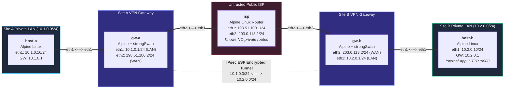

# Understanding VPNs & Implementing an IPsec Site-to-Site Tunnel in Containerlab

## 1. What is a VPN and How Are They Used Today?

A **Virtual Private Network (VPN)** extends a private network across a public or untrusted network (such as the internet). It enables devices or entire branch networks to send and receive data across shared or public infrastructure as if they were directly connected to the private network, benefiting from its security, management policies, and routing.

### How VPNs Work

At a high level, a VPN relies on two core mechanisms:

1. **Encapsulation (Tunneling):** Original IP packets (containing private source and destination addresses) are wrapped inside new outer IP packets with public, routable headers.
2. **Encryption & Authentication:** Protocols like **IPsec** (Internet Protocol Security) or **WireGuard** cryptographically encrypt the inner payload to ensure confidentiality and attach integrity checks (HMAC/AEAD) to prevent tampering.

### Modern Use Cases for VPNs

* **Site-to-Site Connectivity (Branch-to-HQ):** Connecting geographically dispersed office networks over standard internet connections instead of expensive dedicated MPLS leased lines.
* **Hybrid & Multi-Cloud Networking:** Securely linking on-premises data centers to cloud VPCs/VNets (e.g., AWS Site-to-Site VPN, Azure VPN Gateway) or peering workloads across different cloud providers.
* **Remote Access (Zero Trust & Workforce Mobility):** Allowing remote employees to securely authenticate and access internal corporate applications, Git repositories, and databases from untrusted Wi-Fi networks.
* **Consumer Privacy & Bypassing Geo-Restrictions:** Encrypting personal internet traffic to protect against local network snooping and routing traffic through egress servers in specific geographic regions.

---

## 2. Lab Architecture: Site-to-Site IPsec VPN

In this tutorial, we will deploy a 5-node topology in **Containerlab** simulating two isolated private branch networks (`Site A` and `Site B`) communicating across an untrusted ISP router (`isp`) via an **IKEv2 / IPsec** tunnel managed by **strongSwan**.

### Architectural Topology Diagram



> **Key Architectural Detail:** The `isp` router only holds routes for the two public WAN subnets (`198.51.100.0/24` and `203.0.113.0/24`). It has **zero knowledge** of `10.1.0.0/24` or `10.2.0.0/24`. Traffic between `host-a` and `host-b` can only succeed if `gw-a` encapsulates and encrypts the private packets inside outer IPsec ESP packets addressed between `198.51.100.2` and `203.0.113.2`.

---

## 3. Containerlab Topology & IPsec Configuration

### Step 1: Create the strongSwan Configuration Files

Create a directory for your lab (e.g., `mkdir ipsec-lab && cd ipsec-lab`) and create the two strongSwan `swanctl` configuration files that will be bind-mounted into `gw-a` and `gw-b`.

#### 1. Save `gw-a.conf` (Site A VPN Configuration)

```ini
connections {
    site-to-site {
        local_addrs  = 198.51.100.2
        remote_addrs = 203.0.113.2
        version = 2
        proposals = aes256-sha256-modp2048

        local {
            auth = psk
            id = @gw-a.lab
        }
        remote {
            auth = psk
            id = @gw-b.lab
        }
        children {
            net-to-net {
                local_ts  = 10.1.0.0/24
                remote_ts = 10.2.0.0/24
                esp_proposals = aes256-sha256
                start_action = trap
            }
        }
    }
}

secrets {
    ike-lab {
        id-a = @gw-a.lab
        id-b = @gw-b.lab
        secret = "SuperSecretLabKey2026!"
    }
}
```

#### 2. Save `gw-b.conf` (Site B VPN Configuration)

```ini
connections {
    site-to-site {
        local_addrs  = 203.0.113.2
        remote_addrs = 198.51.100.2
        version = 2
        proposals = aes256-sha256-modp2048

        local {
            auth = psk
            id = @gw-b.lab
        }
        remote {
            auth = psk
            id = @gw-a.lab
        }
        children {
            net-to-net {
                local_ts  = 10.2.0.0/24
                remote_ts = 10.1.0.0/24
                esp_proposals = aes256-sha256
                start_action = start
            }
        }
    }
}

secrets {
    ike-lab {
        id-a = @gw-a.lab
        id-b = @gw-b.lab
        secret = "SuperSecretLabKey2026!"
    }
}
```

### Step 2: Create the Containerlab Topology (`ipsec-lab.clab.yml`)

Save the following topology file in the same directory. Notice how `host-b` also runs an internal Python HTTP application on port `8080` to demonstrate an application communicating securely over the tunnel.

```yaml
name: ipsec-lab

topology:
  nodes:
    host-a:
      kind: linux
      image: alpine:latest
      exec:
        - ip addr add 10.1.0.10/24 dev eth1
        - ip route replace default via 10.1.0.1 dev eth1
        - apk add --no-cache curl tcpdump iproute2

    gw-a:
      kind: linux
      image: alpine:latest
      binds:
        - gw-a.conf:/etc/swanctl/conf.d/gw-a.conf
      exec:
        - ip addr add 10.1.0.1/24 dev eth1
        - ip addr add 198.51.100.2/24 dev eth2
        - ip route replace default via 198.51.100.1
        - sysctl -w net.ipv4.ip_forward=1
        - apk add --no-cache strongswan tcpdump iproute2
        - sh -c "charon & sleep 2 && swanctl --load-all"

    isp:
      kind: linux
      image: alpine:latest
      exec:
        - ip addr add 198.51.100.1/24 dev eth1
        - ip addr add 203.0.113.1/24 dev eth2
        - sysctl -w net.ipv4.ip_forward=1
        - apk add --no-cache tcpdump iproute2

    gw-b:
      kind: linux
      image: alpine:latest
      binds:
        - gw-b.conf:/etc/swanctl/conf.d/gw-b.conf
      exec:
        - ip addr add 10.2.0.1/24 dev eth1
        - ip addr add 203.0.113.2/24 dev eth2
        - ip route replace default via 203.0.113.1
        - sysctl -w net.ipv4.ip_forward=1
        - apk add --no-cache strongswan tcpdump iproute2
        - sh -c "charon & sleep 2 && swanctl --load-all"

    host-b:
      kind: linux
      image: alpine:latest
      exec:
        - ip addr add 10.2.0.10/24 dev eth1
        - ip route replace default via 10.2.0.1 dev eth1
        - apk add --no-cache python3 tcpdump iproute2
        - sh -c "echo 'CONFIDENTIAL_INTERNAL_REPORT_DATA' > /tmp/secret.txt && python3 -m http.server 8080 -d /tmp &"

  links:
    - endpoints: ["host-a:eth1", "gw-a:eth1"]
    - endpoints: ["gw-a:eth2", "isp:eth1"]
    - endpoints: ["isp:eth2", "gw-b:eth2"]
    - endpoints: ["gw-b:eth1", "host-b:eth1"]
```

### Step 3: Deploy the Topology

```bash
sudo containerlab deploy -t ipsec-lab.clab.yml
```

---

## 4. Testing VPN Connectivity & Application Traffic

### 1. Check IPsec Security Associations (SAs)

Verify that Phase 1 (IKE SA) and Phase 2 (CHILD SA) negotiated successfully between `gw-a` and `gw-b`:

```bash
docker exec -it clab-ipsec-lab-gw-a swanctl --list-sas
```

*Expected Output Snippet:*
```text
site-to-site: #1, ESTABLISHED, IKEv2, ...
  local  'gw-a.lab' @ 198.51.100.2[4500]
  remote 'gw-b.lab' @ 203.0.113.2[4500]
  AES_CBC-256/HMAC_SHA2_256_128/PRF_HMAC_SHA2_256/MODP_2048
  net-to-net: #1, reqid 1, INSTALLED, TUNNEL, ESP:AES_CBC-256/HMAC_SHA2_256_128
    installed ... 0 bytes_i, 0 bytes_o
    local  10.1.0.0/24
    remote 10.2.0.0/24
```

### 2. Test Layer 3 Ping Across the Tunnel

Ping `host-b` (`10.2.0.10`) from `host-a` (`10.1.0.10`):

```bash
docker exec -it clab-ipsec-lab-host-a ping -c 4 10.2.0.10
```

### 3. Test the Internal Application Over the VPN

Fetch the confidential file hosted on `host-b`'s internal HTTP server from `host-a`:

```bash
docker exec -it clab-ipsec-lab-host-a curl http://10.2.0.10:8080/secret.txt
```

*Expected Output:*
```text
CONFIDENTIAL_INTERNAL_REPORT_DATA
```

---

## 5. Observing Encryption & Kernel XFRM States

To prove that traffic is genuinely encrypted across the ISP and cannot be eavesdropped on, compare packet captures inside the private LAN versus on the public ISP link.

### 1. Capture Plaintext Traffic on the Private LAN (`host-b`)

Run `tcpdump` with `-A` (ASCII payload dump) on `host-b`:

```bash
docker exec -it clab-ipsec-lab-host-b tcpdump -i eth1 -nn -A port 8080
```

Trigger `curl http://10.2.0.10:8080/secret.txt` from `host-a` in another terminal. On `host-b`, you will clearly see the private IPs (`10.1.0.10` $\rightarrow$ `10.2.0.10`) and the plaintext HTTP payload (`CONFIDENTIAL_INTERNAL_REPORT_DATA`).

### 2. Capture Encrypted ESP Traffic on the Public ISP (`isp`)

Now run `tcpdump` on the untrusted `isp` router:

```bash
docker exec -it clab-ipsec-lab-isp tcpdump -i eth1 -nn -X
```

Trigger the `curl` request from `host-a` again.

*Example Output on `isp`:*
```text
16:05:12.441092 IP 198.51.100.2 > 203.0.113.2: ESP(spi=0xc4a19f02,seq=0x5), length 136
        0x0000:  4500 009c 0000 4000 3f32 1a2b c633 6402  E.....@.?2.+.3d.
        0x0010:  cb00 7102 c4a1 9f02 0000 0005 8f3e 12a9  ..q..........>..
        0x0020:  7b91 44c0 91e2 55a1 04d8 77c2 19a0 3b88  {.D...U...w...;.
```

*What to observe:*
* **No Private IPs:** The ISP only sees the outer gateway IPs (`198.51.100.2` $\rightarrow$ `203.0.113.2`).
* **Protocol ESP (IP Protocol 50):** Instead of TCP port `8080`, the packet header shows **Encapsulating Security Payload (ESP)** with a Security Parameter Index (`spi`) and sequence number.
* **Ciphertext Payload:** The hex/ASCII dump (`0x0020` onward) is completely scrambled; `CONFIDENTIAL_INTERNAL_REPORT_DATA` is nowhere to be found.

### 3. Inspect Linux Kernel XFRM Encryption Keys & Policies

Linux handles IPsec packet encryption natively in the kernel via the **XFRM** (transform) framework. You can inspect the active encryption keys and packet byte counters directly on `gw-a`:

* **View active XFRM Security Associations (including raw AES encryption keys):**
  ```bash
  docker exec -it clab-ipsec-lab-gw-a ip xfrm state
  ```

* **View active XFRM Security Policies (which subnets trigger encryption):**
  ```bash
  docker exec -it clab-ipsec-lab-gw-a ip xfrm policy
  ```

* **Verify real-time encrypted byte/packet counters in strongSwan:**
  ```bash
  docker exec -it clab-ipsec-lab-gw-a swanctl --list-sas
  ```
  Look at the `bytes_i` (bytes decrypted inbound) and `bytes_o` (bytes encrypted outbound) counters incrementing each time `host-a` queries `host-b`.

---

## 6. Clean Up

Destroy the lab and remove all virtual interfaces when finished:

```bash
sudo containerlab destroy -t ipsec-lab.clab.yml --cleanup
```
