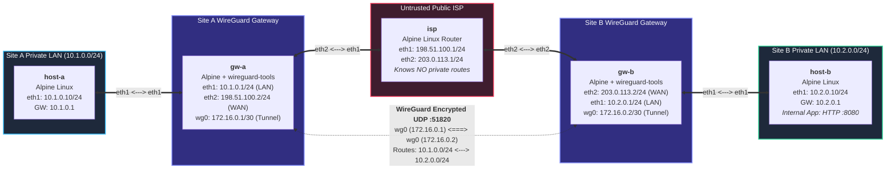

# Understanding VPNs & Implementing a WireGuard Site-to-Site Tunnel in Containerlab

## 1. What is a VPN and How Does WireGuard Differ?

A **Virtual Private Network (VPN)** extends a private network across a public or untrusted network (such as the internet), encapsulating and encrypting traffic so that remote hosts or branch offices can communicate securely.

### Why WireGuard?

While traditional protocols like **IPsec** rely on complex negotiation daemons (IKEv2) and kernel XFRM security policies, **WireGuard** is a modern, high-performance VPN protocol built directly into the Linux kernel that treats VPN tunnels as simple virtual network interfaces (`wg0`):

* **Minimalist Cryptography:** Uses opinionated, state-of-the-art primitives (ChaCha20 for encryption, Poly1305 for authentication, Curve25519 for key exchange, and BLAKE2s for hashing) with zero cipher-suite negotiation.
* **Cryptokey Routing:** Associates public keys directly with allowed IP subnets (`AllowedIPs`). If a packet arrives from a peer, its source IP must match that peer's `AllowedIPs`; if a packet is routed out `wg0`, its destination IP determines which peer's public key encrypts it.
* **Stateless & Stealthy:** Operates over standard UDP (default port `51820`) and remains completely silent unless a peer sends a packet authenticated with a valid public key.

### Modern Use Cases for WireGuard

* **Site-to-Site Branch & Cloud Peering:** Linking office LANs and cloud VPCs using standard Linux routing tables (`ip route`) rather than policy-based IPsec selectors.
* **Zero-Trust Mesh Networks:** Powers modern overlay networks (such as Tailscale and Netmaker) for peer-to-peer connectivity across NATs and firewalls.
* **High-Throughput Remote Access:** Ideal for mobile clients due to seamless roaming—if a client switches from Wi-Fi to cellular, the tunnel persists without renegotiation.

---

## 2. Lab Architecture: Site-to-Site WireGuard VPN

In this tutorial, we will deploy a 5-node topology in **Containerlab** connecting two private branch LANs (`Site A` and `Site B`) across an untrusted ISP router (`isp`). Unlike IPsec, each gateway creates a dedicated Layer 3 virtual interface (`wg0`) and uses standard static IP routes to direct traffic into the tunnel.

### Architectural Topology Diagram



> **Prerequisites Note:** Because Docker containers share the host Linux kernel, ensure the `wireguard` kernel module is loaded on your Containerlab host machine before deploying (`sudo modprobe wireguard`).

---

## 3. Containerlab Topology & WireGuard Configuration

Because WireGuard configurations are short and self-contained, we can configure everything directly inside a single Containerlab YAML file (`wg-lab.clab.yml`). For reproducibility in this lab, we use pre-generated Curve25519 lab keypairs so both gateways peer immediately upon boot.

### Step 1: Create the Containerlab Topology (`wg-lab.clab.yml`)

Create a directory (`mkdir wg-lab && cd wg-lab`) and save the following configuration as `wg-lab.clab.yml`:

```yaml
name: wg-lab

topology:
  nodes:
    host-a:
      kind: linux
      image: alpine:latest
      exec:
        - ip addr add 10.1.0.10/24 dev eth1
        - ip route replace default via 10.1.0.1
        - apk add --no-cache curl tcpdump iproute2

    gw-a:
      kind: linux
      image: alpine:latest
      exec:
        # 1. Configure LAN, WAN, and default route
        - ip addr add 10.1.0.1/24 dev eth1
        - ip addr add 198.51.100.2/24 dev eth2
        - ip route replace default via 198.51.100.1
        - sysctl -w net.ipv4.ip_forward=1
        - apk add --no-cache wireguard-tools tcpdump iproute2

        # 2. Create and configure the WireGuard interface (wg0)
        - ip link add dev wg0 type wireguard
        - ip addr add 172.16.0.1/30 dev wg0
        - sh -c "echo '2B2f9M1x4P7v8L0q3W6y9Z2a5C8e1G4j7M0p3S6v9Y0=' > /tmp/private.key"
        - wg set wg0 listen-port 51820 private-key /tmp/private.key peer l3Q9xR7v2P5m8K1n4J6h9G2f5D8s1A4z7X0c3V6b9N0= allowed-ips 172.16.0.2/32,10.2.0.0/24 endpoint 203.0.113.2:51820 persistent-keepalive 15
        - ip link set up dev wg0

        # 3. Route Site B's subnet into the WireGuard interface
        - ip route add 10.2.0.0/24 dev wg0

    isp:
      kind: linux
      image: alpine:latest
      exec:
        - ip addr add 198.51.100.1/24 dev eth1
        - ip addr add 203.0.113.1/24 dev eth2
        - sysctl -w net.ipv4.ip_forward=1
        - apk add --no-cache tcpdump iproute2

    gw-b:
      kind: linux
      image: alpine:latest
      exec:
        # 1. Configure LAN, WAN, and default route
        - ip addr add 10.2.0.1/24 dev eth1
        - ip addr add 203.0.113.2/24 dev eth2
        - ip route replace default via 203.0.113.1
        - sysctl -w net.ipv4.ip_forward=1
        - apk add --no-cache wireguard-tools tcpdump iproute2

        # 2. Create and configure the WireGuard interface (wg0)
        - ip link add dev wg0 type wireguard
        - ip addr add 172.16.0.2/30 dev wg0
        - sh -c "echo '4D4h1O3z6R9x0N2s5Y8a1B4d7F0h3K6n9Q2t5W8z1C0=' > /tmp/private.key"
        - wg set wg0 listen-port 51820 private-key /tmp/private.key peer u9I2o5P8a1S4d7F0g3H6j9K2l5Z8x1C4v7B0n3M6q90= allowed-ips 172.16.0.1/32,10.1.0.0/24 endpoint 198.51.100.2:51820 persistent-keepalive 15
        - ip link set up dev wg0

        # 3. Route Site A's subnet into the WireGuard interface
        - ip route add 10.1.0.0/24 dev wg0

    host-b:
      kind: linux
      image: alpine:latest
      exec:
        - ip addr add 10.2.0.10/24 dev eth1
        - ip route replace default via 10.2.0.1
        - apk add --no-cache python3 tcpdump iproute2
        - sh -c "echo 'CONFIDENTIAL_WIREGUARD_PAYLOAD' > /tmp/secret.txt && python3 -m http.server 8080 -d /tmp &"

  links:
    - endpoints: ["host-a:eth1", "gw-a:eth1"]
    - endpoints: ["gw-a:eth2", "isp:eth1"]
    - endpoints: ["isp:eth2", "gw-b:eth2"]
    - endpoints: ["gw-b:eth1", "host-b:eth1"]
```

*(Note: If you want to generate fresh keypairs in your own environment, run `wg genkey | tee privatekey | wg pubkey > publickey` on each node and swap the keys accordingly.)*

### Step 2: Deploy the Topology

```bash
sudo modprobe wireguard
sudo containerlab deploy -t wg-lab.clab.yml
```

---

## 4. Testing VPN Connectivity & Application Traffic

### 1. Inspect WireGuard Interface & Handshake Status

Run `wg show` on `gw-a` to inspect the active interface, peer endpoint, allowed IPs, latest cryptographic handshake timestamp, and transfer counters:

```bash
docker exec -it clab-wg-lab-gw-a wg show
```

*Expected Output:*
```text
interface: wg0
  public key: u9I2o5P8a1S4d7F0g3H6j9K2l5Z8x1C4v7B0n3M6q90=
  private key: (hidden)
  listening port: 51820

peer: l3Q9xR7v2P5m8K1n4J6h9G2f5D8s1A4z7X0c3V6b9N0=
  endpoint: 203.0.113.2:51820
  allowed ips: 172.16.0.2/32, 10.2.0.0/24
  latest handshake: 12 seconds ago
  transfer: 1.24 KiB received, 1.48 KiB sent
  persistent keepalive: every 15 seconds
```

### 2. Check the Routing Table on the Gateway

Notice how clean WireGuard routing is compared to IPsec—traffic for `10.2.0.0/24` is simply routed out the `wg0` interface:

```bash
docker exec -it clab-wg-lab-gw-a ip route
```

*Expected Output Snippet:*
```text
default via 198.51.100.1 dev eth2
10.1.0.0/24 dev eth1 scope link src 10.1.0.1
10.2.0.0/24 dev wg0 scope link
172.16.0.0/30 dev wg0 scope link src 172.16.0.1
198.51.100.0/24 dev eth2 scope link src 198.51.100.2
```

### 3. Test End-to-End Ping & Application Traffic

1. **Ping `host-b` (`10.2.0.10`) from `host-a` (`10.1.0.10`):**
   ```bash
   docker exec -it clab-wg-lab-host-a ping -c 4 10.2.0.10
   ```

2. **Query the internal HTTP application on `host-b` across the tunnel:**
   ```bash
   docker exec -it clab-wg-lab-host-a curl http://10.2.0.10:8080/secret.txt
   ```
   *Expected Output:*
   ```text
   CONFIDENTIAL_WIREGUARD_PAYLOAD
   ```

---

## 5. Observing WireGuard Encryption Across the Network

Because WireGuard creates a real virtual network interface (`wg0`), you can observe both the **unencrypted inner IP packets** entering `wg0` and the **ChaCha20-Poly1305 encrypted UDP packets** leaving `eth2` on the exact same router!

### 1. Capture Unencrypted Inner Packets on `wg0` (`gw-a`)

Run `tcpdump` directly on the virtual `wg0` interface of `gw-a`:

```bash
docker exec -it clab-wg-lab-gw-a tcpdump -i wg0 -nn -A port 8080
```

Trigger `curl http://10.2.0.10:8080/secret.txt` from `host-a` in another terminal. Because `wg0` sits *before* encryption on egress (and *after* decryption on ingress), you will see the raw private IPs (`10.1.0.10` $\rightarrow$ `10.2.0.10`) and the plaintext string `CONFIDENTIAL_WIREGUARD_PAYLOAD`.

### 2. Capture Encrypted WireGuard UDP Packets on the ISP (`isp`)

Now run `tcpdump` on the untrusted `isp` router:

```bash
docker exec -it clab-wg-lab-isp tcpdump -i eth1 -nn -X udp port 51820
```

Trigger `curl http://10.2.0.10:8080/secret.txt` from `host-a` again.

*Example Output on `isp`:*
```text
16:42:08.119204 IP 198.51.100.2.51820 > 203.0.113.2.51820: UDP, length 160
        0x0000:  4500 00bc 3a12 0000 3f11 e108 c633 6402  E...:...?....3d.
        0x0010:  cb00 7102 ca6c ca6c 00a8 841b 0400 0000  ..q..l.l........
        0x0020:  8a2f 1900 0000 0000 9f4c 2b8e 71d0 44a1  ./.......L+.q.D.
        0x0030:  e318 77c9 02b4 66f1 5a89 12d4 88e0 31c7  ..w...f.Z.....1.
```

*What to observe:*
* **Standard UDP Transport:** Unlike IPsec (which uses IP Protocol 50 / ESP), WireGuard encapsulates everything inside standard **UDP port 51820** packets between `198.51.100.2` and `203.0.113.2`, making it highly compatible with NAT devices and cloud load balancers.
* **WireGuard Message Type Header:** Look at byte `0x001c` (`0400 0000`). In the WireGuard protocol specification, type `0x04` indicates an encrypted **Transport Data** message, followed by the 4-byte receiver index (`8a2f 1900`) and 8-byte nonce counter (`0000 0000`).
* **Authenticated Ciphertext:** Everything from `0x0028` onward is encrypted with ChaCha20 and authenticated with a 16-byte Poly1305 MAC tag—completely hiding the inner HTTP request and private IP headers.

### 3. Verify Cryptokey Routing Enforcement (`AllowedIPs`)

You can test WireGuard's built-in **Cryptokey Routing** security by attempting to send traffic from an unauthorized source IP across the tunnel.

1. Add a secondary, unauthorized IP address (`10.99.99.10/24`) to `host-a` and route it toward `gw-a`:
   ```bash
   docker exec -it clab-wg-lab-host-a ip addr add 10.99.99.10/24 dev eth1
   ```
2. Try pinging `host-b` sourcing from that unauthorized IP:
   ```bash
   docker exec -it clab-wg-lab-host-a ping -c 2 -I 10.99.99.10 10.2.0.10
   ```
3. **Observe the drop:** `gw-a` immediately drops the packet before it ever leaves `wg0` because `10.99.99.10` is not listed in `gw-b`'s `AllowedIPs` (`172.16.0.2/32, 10.2.0.0/24`). Even if `gw-a` were misconfigured to send it, `gw-b` would reject it upon decryption for the same reason.

---

## 6. Clean Up

Destroy the lab and remove all virtual interfaces when finished:

```bash
sudo containerlab destroy -t wg-lab.clab.yml --cleanup
```
